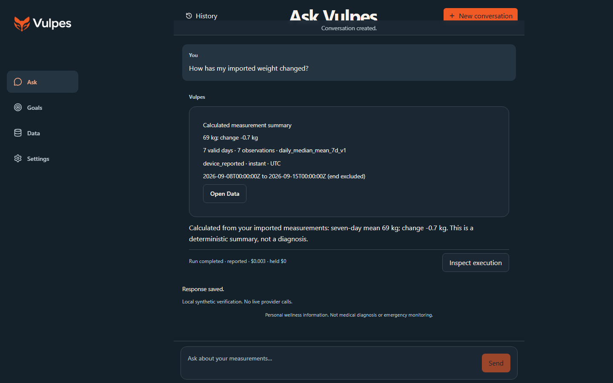
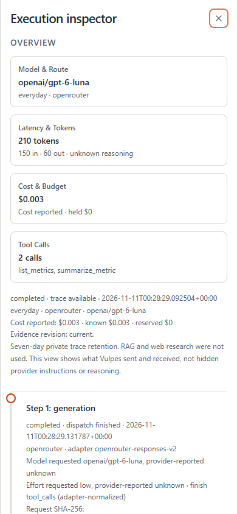
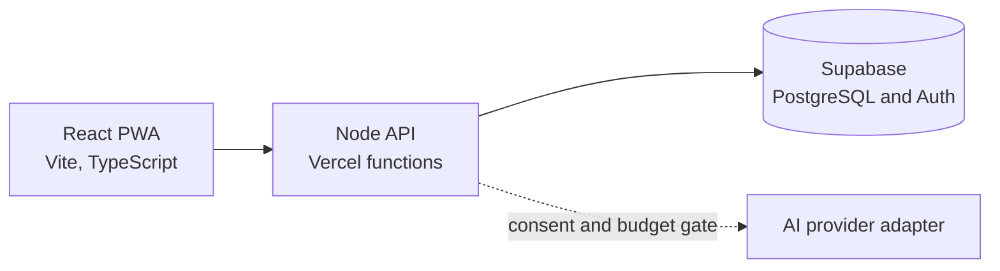

# Vulpes

Vulpes is a personal health app that helps you understand your own measurements. You import your weight, body fat or heart rate, set goals, and ask questions in plain language. Every number comes from a deterministic calculation, and every AI answer can be inspected.

**Status:** v0.1.0, in active development. It is a personal project used by its author, not a service open to other users. It is a wellness tool and does not diagnose or treat medical conditions.

| Ask Vulpes | Execution inspector |
|---|---|
|  |  |

Both screenshots come from a local build with synthetic data.

## What it does

- **Ask:** Chat with an assistant that reads your data through server-side tools. Each answer shows the calculation behind it.
- **Data:** Enter measurements by hand or import a CSV (including a RENPHO scale export). The app previews the import, flags duplicates, and keeps original units and timestamps.
- **Goals:** Set a target such as "reach 68 kg". The assistant can propose a goal, but nothing becomes active until you approve it. Progress is calculated, never written by the model.
- **Inspector:** Open any answer to see the exact request sent to the model, the tool results, the token counts and the cost.
- **Settings:** Choose units and timezone, consent to AI use, cap AI spending, export your data as JSON, or delete your account.

Data and Goals work with the AI switched off. The repository and CI default to no model calls.

## Design choices

- **Deterministic first.** Trends, goal progress and unit conversions use exact decimal math. The model explains results; it does not produce them.
- **Private by default.** Each account is isolated by PostgreSQL row-level security and checked again on the server. Stored AI request traces are encrypted and expire after seven days by default.
- **Consent and budgets.** No request reaches a model provider without the account's consent and a reserved spending budget.
- **Replaceable parts.** Core services do not import AI provider SDKs or the chat UI library. Provider adapters sit behind small interfaces, with tests that check the boundary.
- **Specification first.** Behavior is defined in [written specifications](docs/spec/v0.1.0/) with numbered acceptance tests.

## Built with AI coding agents

Vulpes is developed with AI coding agents, including OpenAI Codex, Cursor, and Antigravity. The author sets the product direction, writes the specifications, makes the design decisions, and reviews and approves the work. The agents write a large share of the code, tests and documentation.

The agents follow the written rules in [AGENTS.md](AGENTS.md), and verification relies on automated tests, specifications and recorded evidence rather than trust in the agent. Material decisions are logged in [implementation decisions](docs/DECISIONS_IMPLEMENTATION.md).

## How it fits together



- **Client:** React, Vite, Tailwind CSS, shadcn/ui, assistant-ui and Recharts, installable as a mobile-first PWA.
- **Server:** Strict TypeScript on Vercel functions, as one modular monolith.
- **Data:** Supabase PostgreSQL with row-level security, Supabase Auth, and AES-256-GCM encryption for private payloads.

## Run it locally

You need Node 24, npm 11.18.0 and Docker, which runs the local Supabase stack. Python 3 is needed only for the specification check.

```sh
npm ci
cp .env.example .env.local
npm run db:start
npm run dev:full
```

Open <http://127.0.0.1:5173>. The API listens on `127.0.0.1:3001`. Until you configure Supabase and create an account, the app shows a "sign-in unavailable" page. [Private account setup](docs/setup/private-accounts.md) explains how.

- Keep real values in `.env.local`, which Git ignores. Never commit credentials or real health data.
- Restart both processes after changing the environment or server code.
- Press Ctrl+C to stop the app and run `npm run db:stop` to stop the database.
- Use only synthetic data in tests. Local Supabase may publish ports on host interfaces, so use a trusted network.

## Checks

| Command | What it checks |
|---|---|
| `npm run format:check` | Prettier formatting |
| `npm run lint` | ESLint rules and module boundaries |
| `npm run typecheck` | Strict TypeScript for client, server and tools |
| `npm test` | Unit tests, with no paid calls |
| `npm run test:spec` | Specification and fixture consistency (needs Python) |
| `npm run build` | Production build |

Database, integration and browser tests need the local Supabase stack. [Release readiness](docs/operations/release-readiness.md) lists them and warns which steps reset a disposable project.

## Documentation

| Read this | To learn |
|---|---|
| [Specifications](docs/spec/v0.1.0/) | What Vulpes does and why: product, architecture, data, API, security, UI and acceptance tests |
| [Implementation decisions](docs/DECISIONS_IMPLEMENTATION.md) | Choices made while building, with dates |
| [Evidence index](docs/evidence/README.md) | Dated test and verification records |
| [Owner operations](docs/operations/owner-pilot-data.md) | Running the hosted deployment |
| [Account lifecycle](docs/operations/account-lifecycle.md) | Export, deletion and retention |
| [Hosted recovery](docs/operations/hosted-recovery.md) | Encrypted backups and restore |
| [Release readiness](docs/operations/release-readiness.md) | Reproducing the evidence and remaining release gates |
| [AGENTS.md](AGENTS.md) | Rules for AI coding agents working in this repository |

## License

Apache-2.0, copyright 2026 Eduardo Marcano. See [LICENSE](LICENSE). Copied source and the Remora agent guidance keep their upstream MIT licenses, listed in [THIRD_PARTY_NOTICES.md](THIRD_PARTY_NOTICES.md).
