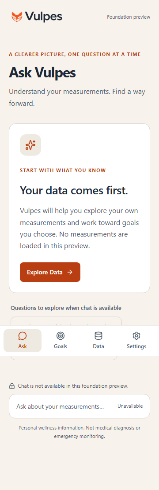
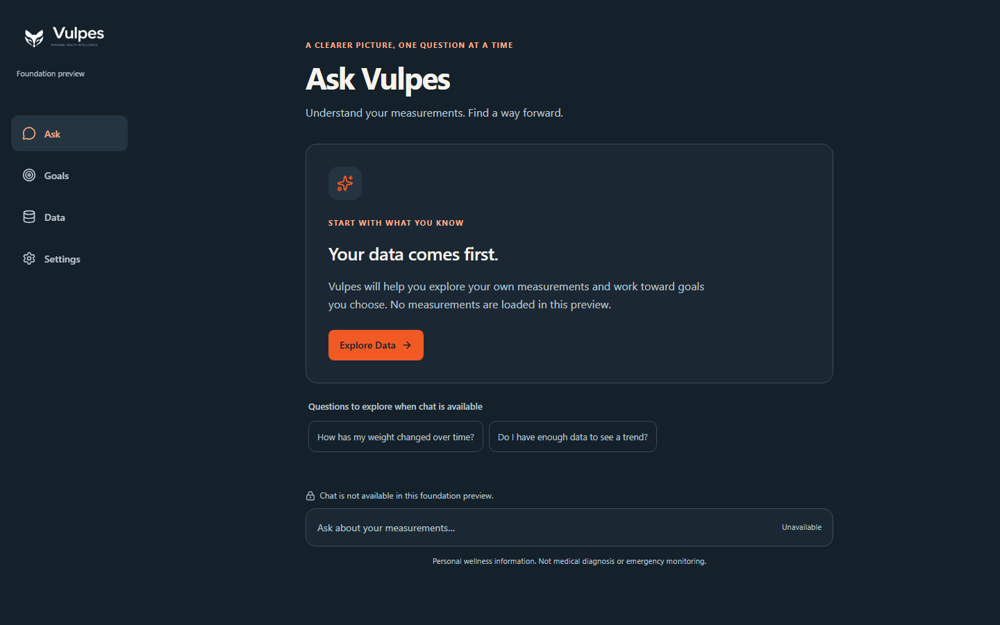

# PR 01 foundation evidence

Verified locally on 2026-10-24 from base `0236a33`, branch `feat/pr01-application-foundation`. Synthetic content only. Node `24.15.0`, npm `11.18.0`, Python `3.14.3`, Playwright Chromium `156.0.8078.4`.

## Commands and observed results

| Command | Result |
|---|---|
| `npm ci --no-fund --no-audit` | Clean lockfile installation passed; 313 packages installed. npm left the optional esbuild postinstall unapproved; the installed native binary supports the verified build/tests. |
| `npm run lint` | Passed, including resolved import boundaries. |
| `npm run typecheck` | Passed for browser, server/API, and tools. |
| `npm test` | 28 checks passed across four files: configuration, real HTTP, import boundaries, real Vite proxy failure, and occupied API port. |
| `npm run build` | Passed; client in `dist/`, executable Node/API output in `.build/`. |
| `npm run test:bundle` | Passed; all six public files inspected with synthetic provider/admin/encryption/path canaries. No canary leakage or public source maps. |
| `npm run test:e2e` | 16 browser/HTTP checks passed. Four screens at five specified viewport sizes in both light/dark modes; 40 synthetic screenshots generated. |
| `npm audit --json` | Zero known vulnerabilities reported. |
| `python docs/spec/v0.1.0/scripts/validate_spec_package.py` | 461 specification/fixture checks passed. |
| `git diff --check` and `git diff --cached --check` | Passed against the final tracked/staged change. |

Builds/browser workers required elevated process execution because the managed Windows sandbox rejected Vite's native process handling with `spawn EPERM`. The same source built and ran successfully outside that restriction; no application behavior was weakened.

## Artifact proof

Actual requests through `npm run dev:full` returned:

| Request | Observed response |
|---|---|
| `GET /api/status` | 200 JSON: `{"data":{"status":"ok"},"request_id":"<server UUID>"}` |
| `POST /api/chat` | 404 JSON: `error.code=not_found` |
| `GET /api/unknown` | 404 JSON: `error.code=not_found` |
| `POST /api/status` | 405 JSON: `error.code=method_not_allowed` |

API responses had `Cache-Control: no-store`. Built-preview tests inspect the same HTTP behavior, production security headers, direct navigation/reload, unavailable authentication pages, navigation focus, disabled chat, no mutation requests, empty browser storage/caches, and no service worker. External browser requests are blocked and fail the tests.

Representative screenshots, captured from the built application:

## Failures and repairs retained in the verification record

| Failure | Evidence and correction |
|---|---|
| Settings incorrectly reported API unavailability | Browser path failed after a successful HTTP response because the TanStack query returned `undefined`. Return the validated liveness value; the same browser path now passes. |
| Browser locator raced navigation | A generic level-two heading locator matched both outgoing Ask headings. Use the unique expected destination heading; retain the same destination assertion. |
| Dark active navigation contrast | Browser measurement failed at 3.797:1. Separate semantic accent text from the original orange; navigation/card accent checks now require at least 4.5:1. |
| Disconnected Vite API proxy returned plain text | Actual preview-only request returned 502 `text/plain` with an empty body. A proxy error hook now returns safe JSON 503; a test exercises Vite itself. Proxy errors omit request URLs and raw errors from logs. |
| Inline type imports escaped boundary checks | The in-memory forbidden-import fixture failed for `type Config = import(...).ServerEnvironment`. Add the TypeScript import-type visitor; the same fixture now passes. |
| Full development stack survived an API startup failure | With port 3001 occupied, `tsx watch` retained a live watcher after the API exited, so the frontend kept running. Remove the API watch wrapper; the regression test now executes `dev:full` and requires exit 1. Restart the stack for server changes. |

## Review and acceptance boundaries

The host performed separate specification-fulfillment and engineering/security/maintainability passes over the actual source, tests, configuration, and complete staged diff. Demonstrated defects above were repaired and their affected checks rerun. Self-review is not independent reviewer certification.

- **Axis 1, specification fulfillment: Approved** for the bounded PR 01 scope, with no remaining demonstrated blocker.
- **Axis 2, engineering/security/maintainability: Approved with observations.** The UI chunk-size warning below is advisory; no remaining demonstrated blocker.

Coverage supports SEC-04, local SEC-08, the shell portion of COST-01/MOD-05, and applicable shell UI checks. It does not close the complete release acceptance IDs or Milestone 0. PR 02 still owns executable domain/SSE contracts, the typed catalog, adapter interfaces, offline provider harness, and public capability verification.

Vercel deployment/routing/functions, physical mobile keyboards, an actual assistive-technology session, persistence, auth/RLS, and live provider behavior remain unverified. Production CSP is exercised locally, with inline styles allowed for UI components. Vite reports an advisory single-chunk warning at approximately 672 kB minified (204 kB gzip); no performance budget or physical-device performance claim is made.

No cloud resources were created, no real health data was used, and no model request occurred. Maximum/actual inference spend: **$0/$0**. No approved scope deviation. Next packet: PR 02 after PR 01 integration; M0 remains open.
