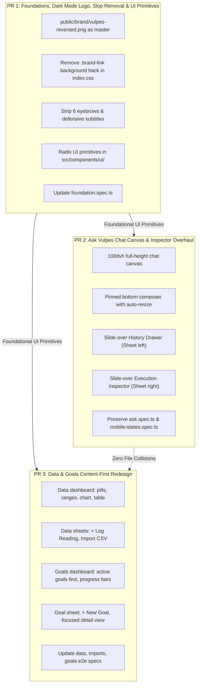

# Vulpes Health UI/UX Overhaul: Production PR Delivery & Execution Plan

This document establishes the authoritative production delivery plan to overhaul the Vulpes Health application UI/UX across three distinct phases as separate pull requests (PRs).
This plan adheres to the foundational specifications in [`../spec/v0.1.0/UI_SPEC.md`](../spec/v0.1.0/UI_SPEC.md), [`../spec/v0.1.0/PRODUCT_SPEC.md`](../spec/v0.1.0/PRODUCT_SPEC.md), [`v0.1.0-execution.md`](v0.1.0-execution.md), and repository standards in [`../../AGENTS.md`](../../AGENTS.md).

---

## 1. Executive Summary & Strategy

The Vulpes Health application delivers calm, precise, personal, and mobile-first health intelligence. While the underlying deterministic analytics, persistent Ask Vulpes agent loop, encrypted private traces, and account isolation are fully implemented and verified, the current user interface retains remnants of early development:
- Dark mode renders the brand logo inside an artificial cream `#f7f3ec` patch rather than using the authentic transparent monochrome master.
- Every primary view is burdened by uppercase promotional eyebrows and defensive engineering subtitles ("AI slop") that dilute a calm, medical-grade experience.
- The Ask Vulpes chat interface suffers from nested viewport scrolling (double scrollbars), an inline conversation picker consuming vertical space, an un-docked composer, and an unstyled raw JSON inspection `<dialog>`.
- The Data (`/data`) and Goals (`/goals`) pages place massive creation forms above the fold, pushing active trends, metric charts, summary statistics, and visual progress bars down or into conditional views.

### Architectural Solution
This overhaul decomposes into **three dependency-bounded, independently verifiable PRs**:
1. **PR 1 (Foundations & Primitives)**: Replaces the logo with responsive `<picture>` rendering `vulpes-reversed.png`, purges the CSS background hack and all promotional eyebrows/defensive subtitles across the app shell and 4 main tabs, and builds accessible shadcn-style primitives (`dialog.tsx`, `sheet.tsx`, `tabs.tsx`, `input.tsx`, `badge.tsx`) in `src/components/ui/` using installed Radix UI packages.
2. **PR 2 (Ask Vulpes Chat Canvas & Inspector)**: Eliminates nested scrolling via a true `100dvh` flex canvas, docks the composer above the mobile keyboard/safe-area, relocates run accounting into thread context, moves conversation history into a left slide-over `Sheet`, and transforms the execution inspector into a right slide-over `Sheet` featuring 4 metric cards, a vertical step timeline, and a tabbed raw payload viewer with 1-click copy and byte export.
3. **PR 3 (Data & Goals Content-First Redesign)**: Reorganizes `/data` and `/goals` into content-first dashboards. Active metric pills, quick time ranges (7D, 14D, 30D, 90D, All), interactive Recharts visualizations, summary cards, active goals with visual progress bars, and the front-and-center measurement table take center stage. Data entry (`ManualForm`), CSV import (`ImportForm`), and goal creation (`GoalForm`) are relocated to slide-over modal sheets.

---

## 2. PR Packaging & Delivery Architecture (R1)

### 2.1 PR Definitions & Scope



| PR | Title | Scope Summary | Milestone | Complexity |
|---|---|---|---|---|
| **PR 1** | Foundations, Dark Mode Logo, AI Slop Removal, & UI Primitives | Brand `<picture>`, CSS cleanup, PWA cache, eyebrow/subtitle purges across 5 views and app shell, shadcn Radix primitives (`dialog`, `sheet`, `tabs`, `input`, `badge`, `button`), `foundation.spec.ts` update. | Phase 1 | Medium |
| **PR 2** | Ask Vulpes Chat Canvas & Execution Inspector Overhaul | Full-height `100dvh` canvas on `/ask`, docked composer, thread context run ledger, left slide-over History Drawer, right slide-over Execution Inspector (4 metric cards, timeline, tabbed payloads). | Phase 2 | High |
| **PR 3** | Data & Goals Content-First Redesign | Content-first `/data` (metric pills, time ranges, summary cards, chart, table), modal sheets for manual entry and CSV import; content-first `/goals` (active goals first, progress bars, focused detail view, `+ New Goal` modal sheet); E2E test updates. | Phase 3 | High |

---

### 2.2 Strict File Ownership & Conflict Matrix

To ensure zero git merge conflicts and clear developer accountability, file ownership is strictly partitioned:

| File Path | PR 1 (Phase 1) | PR 2 (Phase 2) | PR 3 (Phase 3) | Conflict Prevention Protocol |
|---|:---:|:---:|:---:|---|
| `package.json` | **Owns** (add Radix deps) | Reads | Reads | Declared explicitly in PR 1. |
| `scripts/pwa.ts` | **Owns** (cache reversed logo) | None | None | Owned exclusively by PR 1. |
| `src/app/app.tsx` | **Owns** (`<picture>`, clean titles) | Refactors (`main-ask` layout hook) | None | PR 1 lands first; PR 2 adds class hook `app-shell-ask`. |
| `src/index.css` | **Owns** (base tokens, purge patch, pre-allocate Phase 2 & 3 comment delimiters) | **Owns** (chat & inspector CSS inserted under Phase 2 delimiter) | **Owns** (data & goals CSS inserted under Phase 3 delimiter) | PR 1 touches lines 1–175 and appends Phase 2/3 comment banners at EOF; PR 2 inserts between Phase 2 and Phase 3 delimiters; PR 3 inserts after Phase 3 delimiter. Git 3-way merge succeeds with zero collisions. |
| `src/components/ui/button.tsx` | **Owns** (add `ghost` variant, sizes `sm`/`default`/`lg`/`icon`, export `buttonVariants`) | Reads | Reads | Authored in PR 1; consumed across all phases. |
| `src/components/ui/dialog.tsx` | **Creates** | Uses | None | Authored in PR 1; consumed in PR 2. |
| `src/components/ui/sheet.tsx` | **Creates** | Uses | Uses | Authored in PR 1; consumed in PR 2 & 3. |
| `src/components/ui/tabs.tsx` | **Creates** | Uses | None | Authored in PR 1; consumed in PR 2. |
| `src/components/ui/input.tsx` | **Creates** | None | Uses | Authored in PR 1; consumed in PR 3. |
| `src/components/ui/badge.tsx` | **Creates** | Uses | Uses | Authored in PR 1; consumed in PR 2 & 3. |
| `src/features/ask/ask-page.tsx` | Edits (strip eyebrows) | **Owns** (full canvas & history) | None | PR 1 applies minimal line deletions; PR 2 owns full overhaul. |
| `src/features/auth/login-page.tsx` | **Owns** (strip eyebrow) | None | None | Owned exclusively by PR 1. |
| `src/features/executions/inspector.tsx` | None | **Owns** (drawer overhaul) | None | Owned exclusively by PR 2. |
| `src/features/executions/history-drawer.tsx` | None | **Creates** (history sheet) | None | Created exclusively in PR 2. |
| `src/features/data/data-page.tsx` | Edits (strip eyebrows/subtitles) | None | **Owns** (dashboard & sheets) | PR 1 applies minimal line deletions; PR 3 owns full overhaul. |
| `src/features/goals/goals-page.tsx` | Edits (strip eyebrows/subtitles) | None | **Owns** (cards & detail view) | PR 1 applies minimal line deletions; PR 3 owns full overhaul. |
| `src/features/settings/settings-page.tsx` | **Owns** (strip eyebrows/subtitles) | None | None | Owned exclusively by PR 1. |
| `tests/e2e/foundation.spec.ts` | **Owns** (heading & contrast check) | **Edits** (keyboard tab navigation for `/ask` header) | None | PR 1 updates lines 32, 284, 317; PR 2 updates lines 133–144 to match the new History Drawer button and New conversation button replacing `<select>` / checkbox. |
| `tests/e2e/ask.spec.ts` | None | **Owns** | None | Owned exclusively by PR 2. |
| `tests/e2e/mobile-states.spec.ts` | None | **Owns** | None | Owned exclusively by PR 2. |
| `tests/e2e/data.spec.ts` | None | None | **Owns** | Owned exclusively by PR 3. |
| `tests/e2e/imports.spec.ts` | None | None | **Owns** | Owned exclusively by PR 3. |
| `tests/e2e/goals.spec.ts` | None | None | **Owns** | Owned exclusively by PR 3. |
| `tests/e2e/release-journey.spec.ts` | None | None | **Owns** | Owned exclusively by PR 3. |

---

### 2.3 Branching Strategy, Dependencies, & Parallel Feasibility

#### Sequencing Recommendation
The canonical merge sequence is **sequential**:
$$\text{main} \xrightarrow{} \text{PR 1 (Phase 1)} \xrightarrow{\text{merge}} \text{main} \xrightarrow{} \text{PR 2 (Phase 2)} \ \& \ \text{PR 3 (Phase 3)} \xrightarrow{\text{merge}} \text{main}$$

1. **PR 1 merges first**: Establishes UI primitives (`sheet.tsx`, `tabs.tsx`, `dialog.tsx`, `button.tsx`), base styling, and clean headers across all pages.
2. **PR 2 and PR 3 develop in parallel**: Because PR 2 strictly owns `src/features/ask/` + `src/features/executions/` and PR 3 strictly owns `src/features/data/` + `src/features/goals/`, their source code surfaces are **100% disjoint**.
3. **Merging PR 2 and PR 3**: Either PR can merge first without causing file collisions, provided CSS rules are added to distinct sections of `src/index.css`.

#### Parallel Development Feasibility (Zero Blockers)
If developers must start Phase 2 or Phase 3 before PR 1 merges:
- **Approach**: Branch `feature/ui-ux-phase2` and `feature/ui-ux-phase3` off `feature/ui-ux-phase1` (or author PR 1 first as a fast-tracked foundation PR).
- **Radix Primitive Access**: Since `@radix-ui/react-dialog` and `@radix-ui/react-tabs` are already present in `node_modules` (via `@assistant-ui/react`), developers working on Phase 2 or 3 in parallel can import either from `src/components/ui/` or directly without packaging blockers.
- **Zero Merge Conflict CSS Protocol**: By having PR 1 pre-allocate explicit comment section anchors for Phase 2 and Phase 3 at the end of `src/index.css`, PR 2 and PR 3 branch off PR 1 and edit mutually exclusive regions within `src/index.css`. Either PR can merge into `main` first without git merge conflicts.

---

### 2.4 Checkpoint Verification Gates Matrix

Every PR must pass its independent verification gates before merge:

| Gate | Verification Command | PR 1 (Phase 1) | PR 2 (Phase 2) | PR 3 (Phase 3) |
|---|---|:---:|:---:|:---:|
| **Spec Package Validation** | `python docs/spec/v0.1.0/scripts/validate_spec_package.py` | 537 checks pass | 537 checks pass | 537 checks pass |
| **ESLint & Boundaries** | `npm run lint` | 0 errors / 0 warnings | 0 errors / 0 warnings | 0 errors / 0 warnings |
| **TypeScript Strict** | `npm run typecheck` | Clean (app, server, tools) | Clean | Clean |
| **Unit Test Suite** | `npm run test` | 41 suites, 485 tests pass | 41 suites pass | 41 suites pass |
| **PWA Caching Test** | `npm run test:pwa` | Validates `vulpes-reversed.png` | Passes | Passes |
| **Target E2E Tests** | `npx playwright test <spec>` | `tests/e2e/foundation.spec.ts` | `ask.spec.ts`, `mobile-states.spec.ts` | `data.spec.ts`, `imports.spec.ts`, `goals.spec.ts`, `release-journey.spec.ts` |
| **Visual Checkpoint** | Manual browser emulation | Dark mode logo transparency, clean headers | Full-height canvas, docked composer, inspector sheets | Content-first dashboard, metric pills, modal sheets |

---

## 3. Phase 1 Execution Plan: Foundations, Dark Mode Logo, AI Slop Removal, & UI Primitives (R2)

### 3.1 Dark Mode Logo `<picture>` & CSS Patch Purge

#### Observation & Assets
- `public/brand/vulpes-reversed.png`: Authentic 3200 x 1060 transparent monochrome light master (SHA256: `793ee0a3d29da17bc9c6b54b18a9a7d641831dd79b3cc3853153666e65d9a856`).
- `public/brand/vulpes-horizontal.png`: 3200 x 800 dark charcoal wordmark for light surfaces (`#f7f3ec`).
- Current implementation in `src/app/app.tsx:89-94` renders a raw `` of `vulpes-horizontal.png`.
- In `src/index.css:166-168`, dark mode relies on an artificial background patch:
  ```css
  @media (prefers-color-scheme: dark) {
    .brand-link { background: #f7f3ec; border-radius: 0.5rem; padding-inline: 0.35rem; }
  }
  ```

#### Implementation Steps
1. **Refactor Logo in `src/app/app.tsx`**: Replace raw `` with responsive HTML5 `<picture>`:
   ```tsx
   <header className="brand-header">
     <NavLink to="/ask" aria-label="Vulpes home" className="brand-link">
       <picture>
         <source
           media="(prefers-color-scheme: dark)"
           srcSet="/brand/vulpes-reversed.png"
         />
         
       </picture>
     </NavLink>
   </header>
   ```
2. **Purge CSS Patch & Pre-allocate Section Banners in `src/index.css`**:
   - Delete lines 166–168 (`.brand-link { background: #f7f3ec; ... }`).
   - Retain `.brand-link { display: flex; align-items: center; min-height: 44px; flex: 0 0 auto; }` and `.brand-link img { display: block; width: 132px; height: auto; }`.
   - Result: In dark mode, `vulpes-reversed.png` displays crisp white lettering directly over the dark `#14212b` header with 100% transparency. In light mode, `vulpes-horizontal.png` displays dark charcoal lettering over `#f7f3ec`.
   - **Pre-allocated Parallel CSS Delimiters**: Append the following conflict-free section delimiters to EOF of `src/index.css` during PR 1 so PR 2 and PR 3 can merge into `main` in parallel without git merge collisions:
     ```css
     /* ==========================================================================
        Phase 2: Ask Vulpes Chat Canvas & Execution Inspector Styles
        PR 2 appends full-height canvas, docked composer, history drawer, and inspector styles below.
        ========================================================================== */


     /* ==========================================================================
        Phase 3: Data & Goals Content-First Dashboard Styles
        PR 3 appends metric selector pills, time range bars, chart layout, and goal cards below.
        ========================================================================== */
     ```
3. **Synchronize Offline Fallback (`public/offline.html`, `public/offline.css`)**:
   - Update `public/offline.html` to use the same `<picture>` markup.
   - Purge `img{background:#f7f3ec;border-radius:0.5rem}` from `public/offline.css`.

### 3.2 Service Worker Offline Asset Caching (`scripts/pwa.ts`)
Update `scripts/pwa.ts:11-19` to cache both brand assets in the service worker manifest:
```ts
const publicAssets = [
  '/offline.html',
  '/offline.css',
  '/manifest.webmanifest',
  '/icons/favicon-32.png',
  '/icons/vulpes-192.png',
  '/icons/vulpes-512.png',
  '/brand/vulpes-horizontal.png',
  '/brand/vulpes-reversed.png', // Added to offline precache
];
```

---

### 3.3 Exact Coordinates & Removal of Eyebrows, Defensive Subtitles, & Prototype Label

All 6 promotional eyebrows, 3 defensive engineering subtitles, and the prototype badge across the application are pinpointed and will be removed:

| Item | File Path | Line Range | Target String to Remove | Action |
|---|---|---|---|---|
| **E1** | `src/features/ask/ask-page.tsx` | 729–733 | `<p className="eyebrow">A clearer picture, one question at a time</p>` | Delete element. |
| **E2** | `src/features/goals/goals-page.tsx` | 145–147 | `<p className="eyebrow">Progress on your terms</p>` | Delete element. |
| **E3** | `src/features/data/data-page.tsx` | 227–229 | `<p className="eyebrow">Your measurements, with their context</p>` | Delete element. |
| **E4** | `src/features/settings/settings-page.tsx` | 180–182 | `<p className="eyebrow">Clear choices. Personal control.</p>` | Delete element. |
| **E5** | `src/features/ask/ask-page.tsx` | 48–50 | `<p className="eyebrow">Start with what you know</p>` (Welcome card) | Delete element. |
| **E6** | `src/features/auth/login-page.tsx` | 46 | `<p className="eyebrow">Personal Health Intelligence</p>` | Delete element. |
| **S1** | `src/features/data/data-page.tsx` | 230–233 | `<p>Deterministic calculations. No model calls. Preview and confirm CSV imports.</p>` | Delete element. |
| **S2** | `src/features/goals/goals-page.tsx` | 148–151 | `<p>Create and review personal targets without AI. Targets are your requests, without medical validation.</p>` | Delete element. |
| **S3** | `src/features/settings/settings-page.tsx` | 183 | `<p>Your profile and consent belong to this account.</p>` | Delete element. |
| **P1** | `src/app/app.tsx` | 96 | `<span className="preview-label">Private wellness prototype</span>` | Delete element. |
| **CSS**| `src/index.css` | 69, 173 | `.preview-label { font-size: 0.7rem; ... }` | Delete dead rules. |

---

### 3.4 Clean Bold Heading Standard

All main view headings are standardized to clean, confident `<h1>` titles:
- **Ask Vulpes**: `<h1 tabIndex={-1}>Ask Vulpes</h1>` in `src/features/ask/ask-page.tsx:731`.
- **Measurements**: Change `<h1 tabIndex={-1}>Data</h1>` to `<h1 tabIndex={-1}>Measurements</h1>` in `src/features/data/data-page.tsx:229`.
- **Goals**: `<h1 tabIndex={-1}>Goals</h1>` in `src/features/goals/goals-page.tsx:147`.
- **Settings**: `<h1 tabIndex={-1}>Settings</h1>` in `src/features/settings/settings-page.tsx:182`.

---

### 3.5 UI Primitives Architecture & Complete TypeScript Implementation

PR 1 introduces accessible, unstyled, composable primitives in `src/components/ui/` styled with Tailwind tokens and `cn`:

#### 1. `package.json`
Explicitly add Radix dependencies to `dependencies`:
```json
"@radix-ui/react-dialog": "^1.1.6",
"@radix-ui/react-tabs": "^1.1.3"
```

#### 2. `src/components/ui/dialog.tsx`
Provides modal dialogs with backdrop blur, centered card container, title, description, and accessible close button:
- Exports: `Dialog`, `DialogTrigger`, `DialogPortal`, `DialogClose`, `DialogOverlay`, `DialogContent`, `DialogHeader`, `DialogFooter`, `DialogTitle`, `DialogDescription`.
- Uses `@radix-ui/react-dialog` primitives with `data-slot="dialog-*"` attributes.

#### 3. `src/components/ui/sheet.tsx`
Provides slide-over drawers with configurable sides (`top`, `bottom`, `left`, `right`):
- `sheetVariants`:
  - `left`: `inset-y-0 left-0 h-full w-3/4 border-r border-border sm:max-w-md data-[state=closed]:slide-out-to-left data-[state=open]:slide-in-from-left` (used for History Drawer).
  - `right`: `inset-y-0 right-0 h-full w-3/4 border-l border-border sm:max-w-md md:max-w-xl data-[state=closed]:slide-out-to-right data-[state=open]:slide-in-from-right` (used for Execution Inspector & Measurement Logging).
  - `bottom`: `inset-x-0 bottom-0 border-t border-border rounded-t-2xl max-h-[85vh] overflow-y-auto` (mobile action sheets).
- Exports: `Sheet`, `SheetTrigger`, `SheetClose`, `SheetPortal`, `SheetOverlay`, `SheetContent`, `SheetHeader`, `SheetFooter`, `SheetTitle`, `SheetDescription`.

#### 4. `src/components/ui/tabs.tsx`
Provides accessible tabbed navigation using `@radix-ui/react-tabs`:
- Exports: `Tabs`, `TabsList`, `TabsTrigger`, `TabsContent`.
- Styled with `--muted` background, `--card` active pill highlight, and focus-visible rings.

#### 5. `src/components/ui/input.tsx`
Provides styled HTML `<input>` with consistent border, background, focus ring, and disabled states:
- Minimum height `min-h-11` (44px mobile tap target).
- Exports: `Input`.

#### 6. `src/components/ui/badge.tsx`
Provides status badges with `cva` variants:
- Variants: `default` (primary orange), `secondary` (muted gray), `outline` (border), `success` (emerald), `destructive` (red).
- Exports: `Badge`, `badgeVariants`.

#### 7. `src/components/ui/button.tsx`
Extends the existing button component with `ghost` variant and standard size tokens (`default`, `sm`, `lg`, `icon`), exporting `buttonVariants` for shared styling across phases:
- `variant`:
  - `default`: `'bg-primary text-primary-foreground hover:brightness-95'`
  - `outline`: `'border border-border bg-card text-foreground hover:bg-muted'`
  - `ghost`: `'hover:bg-muted hover:text-foreground'` (used by chat header, inspector tabs, and time-range bar)
- `size`:
  - `default`: `'min-h-11 px-4 py-2 text-sm'` (44px mobile touch target)
  - `sm`: `'min-h-9 rounded-md px-3 py-1.5 text-xs'` (compact toolbar actions)
  - `lg`: `'min-h-12 rounded-lg px-8 py-3 text-base'`
  - `icon`: `'min-h-11 min-w-11 p-0'` (44px tap target for icon buttons)
- Exports: `Button`, `buttonVariants`.
- Complete Implementation:
  ```tsx
  import type { ComponentProps } from 'react';
  import { Slot } from '@radix-ui/react-slot';
  import { cva, type VariantProps } from 'class-variance-authority';
  import { cn } from '@/lib/utils';

  export const buttonVariants = cva(
    'inline-flex items-center justify-center gap-2 rounded-lg font-semibold transition-colors disabled:pointer-events-none disabled:opacity-60',
    {
      variants: {
        variant: {
          default: 'bg-primary text-primary-foreground hover:brightness-95',
          outline: 'border border-border bg-card text-foreground hover:bg-muted',
          ghost: 'hover:bg-muted hover:text-foreground',
        },
        size: {
          default: 'min-h-11 px-4 py-2 text-sm',
          sm: 'min-h-9 rounded-md px-3 py-1.5 text-xs',
          lg: 'min-h-12 rounded-lg px-8 py-3 text-base',
          icon: 'min-h-11 min-w-11 p-0',
        },
      },
      defaultVariants: {
        variant: 'default',
        size: 'default',
      },
    },
  );

  export function Button({
    className,
    variant,
    size,
    asChild = false,
    ...props
  }: ComponentProps<'button'> &
    VariantProps<typeof buttonVariants> & { asChild?: boolean }) {
    const Component = asChild ? Slot : 'button';
    return (
      <Component
        data-slot="button"
        className={cn(buttonVariants({ variant, size, className }))}
        {...props}
      />
    );
  }
  ```

---

### 3.6 Foundation Test Suite Updates (`tests/e2e/foundation.spec.ts`)

Two assertions in `tests/e2e/foundation.spec.ts` are updated to match the cleaner layout:
1. **Heading assertion (line 32)**:
   ```ts
   // Before:
   ['/data', 'Data'],
   // After:
   ['/data', 'Measurements'],
   ```
2. **Contrast check locator (lines 284 & 317)**:
   ```ts
   // Before:
   const ratios = await page
     .locator('.nav-link.active, .welcome-card .eyebrow')
     .evaluateAll(...);
   expect(ratios).toHaveLength(2);

   // After (eyebrow removed, asserts active navigation tab):
   const ratios = await page
     .locator('.nav-link.active')
     .evaluateAll(...);
   expect(ratios).toHaveLength(1);
   ```

---

## 4. Phase 2 Execution Plan: Ask Vulpes Chat Canvas & Execution Inspector Overhaul (R3)

### 4.1 Full-Height App Canvas Architecture (`100dvh`, No Nested Scrolling)

#### Root Cause of Nested Scrolling
Currently, `.app-shell` and `.main-content.main-ask` apply global padding (`calc(7rem + env(safe-area-inset-bottom))`) while `.conversation` inside `ask-page.tsx` clamps to `min(70dvh, 50rem)` and `.conversation-viewport` has `overflow-y: auto`. The outer document body overflows by ~30–40dvh, creating double scrollbars and jarring mobile viewport jumps.

#### Layout Overhaul
1. **CSS Viewport Contract (`src/index.css`)**:
   ```css
   /* Ask Vulpes Full-Height Canvas */
   .app-shell-ask,
   .app-shell:has(.main-ask) {
     height: 100dvh;
     max-height: 100dvh;
     overflow: hidden;
     display: flex;
     flex-direction: column;
   }

   /* Mobile (< 768px) */
   @media (max-width: 767px) {
     .main-content.main-ask {
       flex: 1;
       min-height: 0;
       display: flex;
       flex-direction: column;
       padding: 0;
       margin: 0;
       max-width: 100%;
       overflow: hidden;
       padding-bottom: calc(56px + env(safe-area-inset-bottom));
     }
   }

   /* Desktop (>= 768px) */
   @media (min-width: 768px) {
     .app-shell:has(.main-ask) {
       padding-left: 200px;
       height: 100dvh;
     }
     .main-content.main-ask {
       height: 100dvh;
       padding: 0;
       margin: 0;
       max-width: 100%;
       display: flex;
       flex-direction: column;
       overflow: hidden;
     }
   }

   .ask-page {
     display: flex;
     flex-direction: column;
     height: 100%;
     width: 100%;
     max-width: 824px;
     margin: 0 auto;
     overflow: hidden;
   }

   .ask-page .conversation {
     flex: 1;
     min-height: 0;
     display: flex;
     flex-direction: column;
     overflow: hidden;
     height: auto;
   }

   .ask-page .conversation-viewport {
     flex: 1;
     min-height: 0;
     overflow-y: auto;
     overscroll-behavior: contain;
     padding: 1rem 1.25rem;
   }
   ```
2. **Result**: The outer document body never scrolls on `/ask`. Only `.conversation-viewport` scrolls. Double scrollbars are eliminated.

---

### 4.2 Pinned Bottom Composer & Clutter Relocation

#### Modern Composer Structure
- **Container**: Pinned at the base of `.ask-page`, above mobile navigation and safe-area padding:
  ```css
  .composer-area {
    flex-shrink: 0;
    padding: 0.75rem 1rem calc(0.75rem + env(safe-area-inset-bottom));
    background: var(--background);
    border-top: 1px solid var(--border);
  }
  ```
- **Textarea**:
  - Replace muted color with `color: var(--foreground)`.
  - Auto-resizing: Set `field-sizing: content; min-height: 2.75rem; max-height: 10rem;` with smooth expansion.
  - Maintain accessible label: `aria-label="Message Ask Vulpes"`.
- **Send & Stop Controls**:
  - Integrate inside the composer input card.
  - When idle: `ComposerPrimitive.Send` with `Button` (label "Send").
  - When streaming/busy: `Button` calling `stop.mutateAsync()` (label "Stop").

#### Relocating Run Ledger & Disclaimers
1. **Run Ledger Relocation**:
   - Currently cluttering the bottom of the input form (`src/features/ask/ask-page.tsx:609-617`).
   - Relocate into **thread context**: Render directly below the corresponding assistant message bubble alongside the `Inspect execution` button:
     ```tsx
     {latest?.run && (
       <div className="message-run-meta">
         <p role="status" className="availability-note">
           Run {latest.run.state} · {latest.run.costStatus} ·{' '}
           {latest.run.costUSD === null ? 'Total cost unknown' : `$${latest.run.costUSD}`}{' '}
           · held ${latest.run.reservationUSD}
         </p>
         <Button variant="outline" size="sm" onClick={() => setInspectorRunId(latest.run.id)}>
           Inspect execution
         </Button>
       </div>
     )}
     ```
   - *Advantage*: Scannable alongside the specific answer; preserves Playwright assertion `page.getByText(/Run completed · reported · \$0.003/)`.
2. **Wellness Disclaimer Relocation**:
   - Move `Personal wellness information. Not medical diagnosis or emergency monitoring.` from composer to the thread footer or initial welcome card.
3. **Availability & Retry Actions**:
   - Render provider unavailability notices and retry triggers as contextual toast banners or thread status notices rather than permanent stacked form elements.

---

### 4.3 Slide-Over History Drawer (`side="left"`) & Header "+ New Chat" Action

#### Architecture & Placement
The clunky inline `<select>` dropdown, archived checkbox, and `<details>` delete disclosure (`ask-page.tsx:734-814`) are replaced with a sleek Chat Header:

```tsx
<header className="chat-canvas-header">
  <Button
    variant="ghost"
    size="sm"
    aria-label="Conversation history"
    onClick={() => setHistoryOpen(true)}
  >
    <History className="h-4 w-4" />
    <span className="hidden sm:inline">History</span>
  </Button>
  
  <h1 tabIndex={-1} className="text-base font-semibold">Ask Vulpes</h1>
  
  <Button
    size="sm"
    aria-label="New conversation"
    onClick={() => createConversation.mutate('create')}
  >
    <Plus className="h-4 w-4" />
    <span>New conversation</span>
  </Button>
</header>
```

#### `HistoryDrawer` Component (`src/features/executions/history-drawer.tsx`)
Rendered inside a Radix `Sheet` sliding in from `side="left"`:
- **Header**: `SheetTitle` ("Conversation history"), `SheetDescription` ("Switch threads, browse archives, or manage storage").
- **Filter Bar**: `<label className="checkbox-label"><input type="checkbox" checked={archived} onChange={...} /> Archived</label>`.
- **List Items**:
  - Thread button: Displays conversation title or relative timestamp (`Temporal.Instant.from(item.createdAt)`).
  - Active indicator badge.
  - Quick action: `Archive conversation` button (`mutation.mutate('archive')`).
  - Delete action: Accessible confirmation dialog (`Confirm delete conversation` button).
- **Pagination**: `Load more conversations` button when `hasNextPage` is true.
- **Test Compatibility**: Preserves all Playwright selectors (`New conversation`, `Archive conversation`, `Archived`, `Confirm delete conversation`, `Load more conversations`).

---

### 4.4 Execution Inspector Redesign (`side="right"`)

#### Overhaul from HTML `<dialog>` to Radix `Sheet`
The raw `<dialog ref={dialog} className="inspection-dialog">` is replaced with `Sheet` (`side="right"`), styled with responsive widths (`w-full sm:max-w-2xl md:max-w-3xl`) and preserved accessibility roles (`role="dialog"`, title "Execution inspector", trigger button "Inspect execution").

#### 1. Overview Section with Four Summary Metric Cards (Preserving `tests/e2e/mobile-states.spec.ts:77,94`)
The top of the inspector drawer wraps the 4 metric cards and disclosures inside `<section className="inspector-overview" aria-labelledby="inspector-overview-heading">` containing `<h3 id="inspector-overview-heading">Overview</h3>`, ensuring mobile state test assertions pass without regression:

```tsx
<section className="inspector-overview" aria-labelledby="inspector-overview-heading">
  <h3
    id="inspector-overview-heading"
    className="text-sm font-semibold uppercase tracking-wider text-muted-foreground mb-3"
  >
    Overview
  </h3>

  <div className="inspector-metrics-grid grid grid-cols-2 gap-3 mb-4">
    {/* Card 1: Model & Route */}
    <Card className="metric-card p-3 rounded-lg border bg-card">
      <span className="metric-label text-xs text-muted-foreground">Model & Route</span>
      <div className="metric-value text-sm font-semibold truncate">
        {overview.run.route?.model ?? 'No model'}
      </div>
      <div className="metric-sub text-xs text-muted-foreground truncate">
        {overview.run.route?.role ?? 'No role'} · {overview.run.route?.provider ?? 'unknown provider'}
      </div>
    </Card>

    {/* Card 2: Latency & Tokens */}
    <Card className="metric-card p-3 rounded-lg border bg-card">
      <span className="metric-label text-xs text-muted-foreground">Latency & Tokens</span>
      <div className="metric-value text-sm font-semibold">
        {formatDuration(overview.run.admittedAt, overview.run.finishedAt)}
      </div>
      <div className="metric-sub text-xs text-muted-foreground">
        {totalTokens.input} in · {totalTokens.output} out · {totalTokens.reasoning} reasoning
      </div>
    </Card>

    {/* Card 3: Financial Settlement */}
    <Card className="metric-card p-3 rounded-lg border bg-card">
      <span className="metric-label text-xs text-muted-foreground">Cost & Budget</span>
      <div className="metric-value text-sm font-semibold">
        {overview.run.costUSD === null ? 'unknown' : `$${overview.run.costUSD}`}
      </div>
      <div className="metric-sub text-xs text-muted-foreground">
        Cost {overview.run.costStatus} · held ${overview.run.reservationUSD}
      </div>
    </Card>

    {/* Card 4: Agent Tool Invocations */}
    <Card className="metric-card p-3 rounded-lg border bg-card">
      <span className="metric-label text-xs text-muted-foreground">Tool Calls</span>
      <div className="metric-value text-sm font-semibold">
        {toolSteps.length} calls
      </div>
      <div className="metric-sub text-xs text-muted-foreground truncate">
        {toolNames.join(', ') || 'No tools invoked'}
      </div>
    </Card>
  </div>

  {/* Trace, Audit & Verification Notes (Preserves lines 306-339) */}
  <div className="inspector-overview-meta space-y-1 text-xs text-muted-foreground">
    <p>
      {overview.run.state} · trace {overview.run.traceState} · {overview.run.admittedAt}
    </p>
    <p>
      Cost {overview.run.costStatus}: {overview.run.costUSD === null ? 'unknown' : `$${overview.run.costUSD}`} · known ${overview.run.knownCostUSD} · reserved ${overview.run.reservationUSD}
    </p>
    {overview.routeHistory.map((change) => (
      <p key={change.sourceStepId}>
        Authorized handoff: Everyday → Intermediate · {change.reason}
      </p>
    ))}
    <p>
      Evidence revision: {overview.evidenceRevision}
      {overview.evidenceRevision === 'stale' ? ' (historical; current data has changed)' : ''}.
    </p>
    <p>
      Seven-day private trace retention. RAG and web research were not used. This view shows what Vulpes sent and received, not hidden provider instructions or reasoning.
    </p>
  </div>
</section>
```

#### 2. Vertical Step Timeline
Replaces unstyled `<section>` step lists with an interconnected vertical timeline:
- Connecting vertical line (`border-l-2 border-border`) with circular step milestone nodes.
- Heading per step: `<h3 className="step-title">Step {step.sequence}: {step.type}{step.toolName ? ' · ' + step.toolName : ''}</h3>` (strictly matches Playwright heading regex).
- Badges: `status` ('completed', 'failed'), finish reason (`tool_calls (adapter-normalized)`, `stop (adapter-normalized)`).
- Details: Duration, tokens, cost bound, and model resolution note (`Model requested openai/gpt-6-luna, provider-reported unknown`).

#### 3. Step-Scoped Action Buttons & Payload Viewer (`tests/e2e/ask.spec.ts:161-196`)
To maintain 100% selector parity with Playwright assertions on `.inspection-step`, the payload loading buttons (`Load input`, `Load output`, `Load context`, `Load usage`) are rendered as always-visible `<Button>` elements (with `role="button"`) directly inside each step, rather than being hidden behind unmounted `role="tab"` triggers:

```tsx
{/* Inside query.data.steps.map((step) => ...) */}
<section
  key={step.id}
  className="inspection-step relative pl-6 border-l-2 border-border mb-6"
  data-step-id={step.id}
>
  {/* Step milestone node on vertical line */}
  <div className="absolute -left-2 top-0 h-4 w-4 rounded-full border-2 border-primary bg-background" />

  {/* Step Heading (Preserves heading regex /Step \d+: .../ and /summarize_metric/) */}
  <h3 className="step-title text-sm font-semibold">
    Step {step.sequence}: {step.type}{step.toolName ? ` · ${step.toolName}` : ''}
  </h3>

  <div className="step-meta space-y-1 text-xs text-muted-foreground mt-1 mb-3">
    <p>{step.status} · dispatch {step.dispatchState} · {step.startedAt}</p>
    <p>{step.provider ?? 'Local tool'} · adapter {step.adapterVersion ?? 'unknown'}</p>
    <p>Model requested {step.model ?? 'none'}, provider-reported {step.effectiveModel ?? 'unknown'}</p>
    <p>
      Effort requested {step.requestedEffort ?? 'unknown'}, provider-reported {step.effectiveEffort ?? 'unknown'} · finish {step.finishReason ?? 'unknown'} (adapter-normalized)
    </p>
    <p>Request SHA-256: {step.requestBodyHash ?? 'unavailable'}</p>
    <p>
      Cost {step.costStatus}: {step.costUSD === null ? 'unknown' : `$${step.costUSD}`} · bound {step.costBoundState}
    </p>
    <p>
      Tokens: input {step.usage.inputTokens ?? 'unknown'}, output {step.usage.outputTokens ?? 'unknown'}, reasoning {step.usage.reasoningTokens ?? 'unknown'}
    </p>
    <details>
      <summary>Request metadata and price snapshot</summary>
      <pre className="inspection-raw">
        {JSON.stringify(
          {
            request: step.requestMetadata,
            price: step.priceSnapshot,
            providerRequestId: step.providerRequestId,
          },
          null,
          2,
        )}
      </pre>
    </details>
  </div>

  {/* Step-Scoped Payload Viewer with Action Buttons & Tabbed Evidence */}
  <StepPayloadViewer run={run} step={step} />
</section>
```

Where `StepPayloadViewer` provides:
```tsx
function StepPayloadViewer({ run, step }: { run: string; step: InspectionStep }) {
  const [activePart, setActivePart] = useState<'input' | 'output' | 'context' | 'usage'>('input');
  const [loadedParts, setLoadedParts] = useState<Record<string, boolean>>({});

  function handleTriggerLoad(part: 'input' | 'output' | 'context' | 'usage') {
    setActivePart(part);
    setLoadedParts((prev) => ({ ...prev, [part]: true }));
  }

  return (
    <div className="step-payload-container border rounded-md p-3 bg-muted/20">
      {/* 1. Step-Scoped Action Buttons (ALWAYS visible with role="button" matching Playwright queries) */}
      <div className="step-payload-actions flex flex-wrap gap-2 mb-3">
        <Button
          variant={activePart === 'input' && loadedParts['input'] ? 'default' : 'outline'}
          size="sm"
          onClick={() => handleTriggerLoad('input')}
        >
          Load input
        </Button>
        <Button
          variant={activePart === 'output' && loadedParts['output'] ? 'default' : 'outline'}
          size="sm"
          onClick={() => handleTriggerLoad('output')}
        >
          Load output
        </Button>
        {step.type !== 'tool' && (
          <>
            <Button
              variant={activePart === 'context' && loadedParts['context'] ? 'default' : 'outline'}
              size="sm"
              onClick={() => handleTriggerLoad('context')}
            >
              Load context
            </Button>
            <Button
              variant={activePart === 'usage' && loadedParts['usage'] ? 'default' : 'outline'}
              size="sm"
              onClick={() => handleTriggerLoad('usage')}
            >
              Load usage
            </Button>
          </>
        )}
      </div>

      {/* 2. Loaded Evidence displaying <pre>, copy button, export button, or context/sources */}
      {loadedParts[activePart] ? (
        <Evidence
          run={run}
          step={step.id}
          part={activePart}
          incomplete={activePart === 'output' && step.status !== 'completed'}
          initialVisible={true}
        />
      ) : (
        <p className="text-xs text-muted-foreground italic">
          Click an action above to load and inspect raw payload bytes.
        </p>
      )}
    </div>
  );
}
```
This guarantees:
- `first.getByRole('button', { name: 'Load input' })`, `first.getByRole('button', { name: 'Load context' })`, and `summaryStep.getByRole('button', { name: 'Load output' })` directly find their target buttons.
- Triggering `Load [part]` loads the evidence and renders `<pre>` with `"model"`, `Copy exact text`, `Export exact bytes`, `Copied exact text.`, `<h5>Included</h5>`, and `<h5>Calculation and sources</h5>` inside `first` and `summaryStep`.

---

### 4.5 Accessible Selectors & Playwright Test Stability

PR 2 synchronizes and preserves all selectors across the test suites:

#### 1. Foundation Keyboard Tab Order Synchronization (`tests/e2e/foundation.spec.ts:133-144`)
Because PR 2 removes the inline `<select aria-label="Conversation">` combobox and `Archived` checkbox from the top of `/ask`, lines 133–144 of `tests/e2e/foundation.spec.ts` are updated to match the accessible header button tab order:
```ts
// BEFORE (tests/e2e/foundation.spec.ts:133-144):
  await page.keyboard.press('Tab');
  await expect(
    page.getByRole('button', { name: 'New conversation', exact: true }),
  ).toBeFocused();
  await page.keyboard.press('Tab');
  await expect(
    page.getByRole('combobox', { name: 'Conversation', exact: true }),
  ).toBeFocused();
  await page.keyboard.press('Tab');
  await expect(page.getByLabel('Archived', { exact: true })).toBeFocused();
  await page.keyboard.press('Tab');
  await expect(page.getByRole('link', { name: 'Explore Data' })).toBeFocused();

// AFTER (PR 2: Chat Canvas Header tab sequence):
  await page.keyboard.press('Tab');
  await expect(
    page.getByRole('button', { name: 'Conversation history', exact: true }),
  ).toBeFocused();
  await page.keyboard.press('Tab');
  await expect(
    page.getByRole('button', { name: 'New conversation', exact: true }),
  ).toBeFocused();
  await page.keyboard.press('Tab');
  await expect(page.getByRole('link', { name: 'Explore Data' })).toBeFocused();
```

#### 2. History Drawer Opening for Archive & Deletion Tests (`tests/e2e/ask.spec.ts:526-538`)
Because conversation archive and delete controls are now encapsulated inside `HistoryDrawer`, `tests/e2e/ask.spec.ts:526-538` opens the drawer before interacting with the controls:
```ts
// Helper in tests/e2e/ask.spec.ts:
async function openHistory(page: Page) {
  const historyButton = page.getByRole('button', {
    name: 'Conversation history',
    exact: true,
  });
  const drawer = page.getByRole('dialog', { name: 'Conversation history' });
  if (!(await drawer.isVisible())) {
    await historyButton.click();
    await expect(drawer).toBeVisible();
  }
}

// BEFORE (lines 526-538):
  await page
    .getByRole('button', { name: 'Archive conversation', exact: true })
    .click();
  await page.getByLabel('Archived', { exact: true }).check();
  await expect(page.getByLabel('Message Ask Vulpes')).toBeDisabled();
  await page.getByText('Delete conversation', { exact: true }).click();
  await page
    .getByRole('button', { name: 'Confirm delete conversation', exact: true })
    .click();
  await expect(
    page.getByText('Conversation deleted.', { exact: true }),
  ).toBeVisible();

// AFTER:
  await page
    .getByRole('button', { name: 'Conversation history', exact: true })
    .click();
  await page
    .getByRole('button', { name: 'Archive conversation', exact: true })
    .click();
  await page.getByLabel('Archived', { exact: true }).check();
  await expect(page.getByLabel('Message Ask Vulpes')).toBeDisabled();
  await page.getByText('Delete conversation', { exact: true }).click();
  await page
    .getByRole('button', { name: 'Confirm delete conversation', exact: true })
    .click();
  await expect(
    page.getByText('Conversation deleted.', { exact: true }),
  ).toBeVisible();
```

#### 3. Preserved Selectors Summary
- Header action: `page.getByRole('button', { name: 'New conversation', exact: true })`
- Drawer trigger: `page.getByRole('button', { name: 'Conversation history', exact: true })`
- Input field: `page.getByLabel('Message Ask Vulpes')`
- Run status: `page.getByText(/Run completed · reported · \$0.003/)`
- Inspector dialog: `page.getByRole('dialog', { name: 'Execution inspector' })`
- Headings: `getByRole('heading', { name: 'Overview' })`, `getByRole('heading', { name: 'Step 5: generation' })`
- Payload buttons: `getByRole('button', { name: 'Load input' })`, `getByRole('button', { name: 'Copy exact text' })`, `getByRole('button', { name: 'Export exact bytes' })`
- Close button: `getByRole('button', { name: 'Close' })`

---

## 5. Phase 3 Execution Plan: Data & Goals Content-First Redesign (R4)

### 5.1 Content-First Data Dashboard (`/data` / Measurements)

#### Current Shortcomings
In `src/features/data/data-page.tsx`, `<ManualForm>` (336 lines) and `<ImportForm>` (667 lines) sit at the top of the page. Users must scroll past 1,000+ lines of form inputs to view recent measurements or inspect their trend chart.

#### Restructured Layout Hierarchy
```tsx
<div className="data-page">
  {/* 1. Header with Clean Title & Primary Actions */}
  <header className="page-header flex justify-between items-center">
    <div>
      <h1 tabIndex={-1}>Measurements</h1>
      <p className="text-sm text-muted-foreground">Deterministic health analytics and audited observations</p>
    </div>
    <div className="header-actions flex gap-2">
      <Button variant="outline" onClick={() => setImportOpen(true)}>
        <Upload className="h-4 w-4 mr-1" />
        Import CSV
      </Button>
      <Button onClick={() => setManualOpen(true)}>
        <Plus className="h-4 w-4 mr-1" />
        + Log Reading
      </Button>
    </div>
  </header>

  {/* 2. Metric Selector Horizontal Pills */}
  <nav className="metric-pills-bar" aria-label="Select metric">
    {registeredMetrics.map(m => (
      <button
        key={m.key}
        className={cn('metric-pill', metric === m.key && 'metric-pill-active')}
        onClick={() => setMetric(m.key)}
      >
        <m.Icon className="h-4 w-4" />
        <span>{m.label}</span>
      </button>
    ))}
  </nav>

  {/* 3. Quick Time Ranges & Interval Bar */}
  <div className="time-range-bar flex justify-between items-center">
    <div className="range-pills flex gap-1">
      {(['7D', '14D', '30D', '90D', 'All (365D)'] as const).map(range => (
        <Button
          key={range}
          variant={selectedRange === range ? 'default' : 'ghost'}
          size="sm"
          onClick={() => applyQuickRange(range)}
        >
          {range}
        </Button>
      ))}
    </div>
    <Button variant="ghost" size="sm" onClick={() => setCustomDateOpen(!customDateOpen)}>
      <Calendar className="h-4 w-4 mr-1" />
      {from} to {to}
    </Button>
  </div>

  {/* 4. Responsive Summary Metric Cards */}
  <section className="summary-grid grid grid-cols-2 md:grid-cols-4 gap-4" aria-label="Deterministic summary">
    <Card className="summary-card">
      <span className="text-xs text-muted-foreground uppercase font-semibold">Latest Reading</span>
      <span data-testid="headline-value" className="text-2xl font-bold">
        {formatMeasurement(summary?.latest?.value, locale)} {unit}
      </span>
      <span className="text-xs text-muted-foreground">{summary?.latest?.recordedAt}</span>
    </Card>
    <Card className="summary-card">
      <span className="text-xs text-muted-foreground uppercase font-semibold">Period Trend</span>
      <span className="text-lg font-semibold">{summary?.delta != null ? `${summary.delta > 0 ? '+' : ''}${summary.delta} ${unit}` : 'Stable'}</span>
      <span className="text-xs text-muted-foreground">Across {summary?.validDays ?? 0} valid days</span>
    </Card>
    <Card className="summary-card">
      <span className="text-xs text-muted-foreground uppercase font-semibold">Observations</span>
      <span className="text-lg font-semibold">{summary?.observationCount ?? 0} logged</span>
      <span className="text-xs text-muted-foreground">{summary?.coveragePercent ?? 100}% coverage</span>
    </Card>
    <Card className="summary-card">
      <span className="text-xs text-muted-foreground uppercase font-semibold">Data Revision</span>
      <span className="text-lg font-semibold font-mono text-xs">{summary?.revision ?? 'rev_1'}</span>
      <span className="text-xs text-muted-foreground">Audited deterministic state</span>
    </Card>
  </section>

  {/* 5. Interactive Trend Chart */}
  <section className="chart-card-container">
    <DataChartView data={data} />
  </section>

  {/* 6. Measurement Table Front-and-Center */}
  <section className="table-card-container">
    <div className="flex justify-between items-center mb-4">
      <h2 className="text-lg font-semibold">Observation ledger</h2>
      <Button variant="outline" size="sm" onClick={() => handleExport()}>
        <Download className="h-4 w-4 mr-1" />
        Export CSV
      </Button>
    </div>
    <div className="data-table-scroll">
      {/* Scrollable table with inline MeasurementEditor */}
    </div>
  </section>

  {/* 7. Modal Sheets for Entry & Import */}
  <Sheet open={manualOpen} onOpenChange={setManualOpen}>
    <SheetContent side="right" className="w-full sm:max-w-lg overflow-y-auto">
      <SheetHeader>
        <SheetTitle>Manual measurement</SheetTitle>
        <SheetDescription>Log a verified health reading into your account</SheetDescription>
      </SheetHeader>
      <ManualForm onSuccess={() => { setManualOpen(false); refetch(); }} />
    </SheetContent>
  </Sheet>

  <Sheet open={importOpen} onOpenChange={setImportOpen}>
    <SheetContent side="right" className="w-full sm:max-w-2xl overflow-y-auto">
      <SheetHeader>
        <SheetTitle>Import CSV</SheetTitle>
        <SheetDescription>Preview, map columns, and confirm batch records</SheetDescription>
      </SheetHeader>
      <ImportForm onSuccess={() => { setImportOpen(false); refetch(); }} />
    </SheetContent>
  </Sheet>
</div>
```

#### Quick Time Range Calculation Logic
Temporal calculation for preset buttons:
- `7D`: `today.subtract({ days: 6 })` to `today` (7 calendar days).
- `14D`: `today.subtract({ days: 13 })` to `today` (14 calendar days).
- `30D`: `today.subtract({ days: 29 })` to `today` (30 calendar days).
- `90D`: `today.subtract({ days: 89 })` to `today` (90 calendar days).
- `All (365D)` / `1Y`: Calculates up to 365 days (`today.subtract({ days: 364 })` to `today`, yielding `days = 364 < 366`). This strictly respects the 366-day Temporal constraint in `src/features/data/data-page.tsx:109-112` (`if (days < 0 || days >= 366) { selection = null; intervalError = 'Select 1–366 local calendar days.'; }`).

---

### 5.2 Content-First Goals Dashboard (`/goals`)

#### Current Shortcomings
In `src/features/goals/goals-page.tsx`, the massive `GoalForm` (15+ fields) occupies the first card. Users must scroll down past the creation form to view their active goals, while progress bars are buried inside subcomponents.

#### Restructured Layout Hierarchy
```tsx
<div className="goals-page">
  {/* 1. Header with Clean Title & + New Goal Button */}
  <header className="page-header flex justify-between items-center">
    <div>
      <h1 tabIndex={-1}>Goals</h1>
      <p className="text-sm text-muted-foreground">Personal health targets and audited deterministic progress</p>
    </div>
    <Button onClick={() => setGoalFormOpen(true)}>
      <Plus className="h-4 w-4 mr-1" />
      + New Goal
    </Button>
  </header>

  {/* 2. Active Goals List with Visual Progress Bars */}
  <section className="active-goals-section" aria-label="Active goals">
    <h2 className="text-lg font-semibold mb-3">Active targets</h2>
    <div className="grid grid-cols-1 md:grid-cols-2 gap-4">
      {goals.map(goal => (
        <Card
          key={goal.id}
          className={cn('goal-card cursor-pointer hover:border-primary transition-all', selectedGoalId === goal.id && 'border-primary ring-1 ring-primary')}
          onClick={() => setSelectedGoalId(goal.id)}
        >
          <div className="flex justify-between items-start mb-2">
            <div>
              <h3 className="font-semibold text-base">{goal.title}</h3>
              <p className="text-sm text-muted-foreground">{goal.targetDescription}</p>
            </div>
            <Badge variant={goal.status === 'active' ? 'default' : 'secondary'}>
              {goal.status}
            </Badge>
          </div>

          {/* Visual Progress Bar Front-and-Center */}
          <div className="my-3">
            <div className="flex justify-between text-xs mb-1">
              <span>Progress</span>
              <span className="font-semibold">{goal.progressPercent ?? 0}%</span>
            </div>
            <progress
              className="goal-progress-bar w-full h-2.5 rounded-full"
              max={100}
              value={goal.progressPercent ?? 0}
              aria-label="Goal progress"
            />
          </div>

          <div className="flex justify-between text-xs text-muted-foreground mt-2">
            <span>Current: {goal.currentValue}</span>
            <span>Target: {goal.targetValue}</span>
          </div>
        </Card>
      ))}
    </div>
  </section>

  {/* 3. Focused Goal Detail View (Conditional on Selection or ?goal=<id>) */}
  {selectedGoal && (
    <section className="goal-detail-card" aria-label="Goal details">
      <div className="flex justify-between items-center mb-4">
        <h2 className="text-xl font-bold">{selectedGoal.title}</h2>
        <div className="flex gap-2">
          {/* Status Transitions: Review active, Review paused, Review completed, Review archived */}
          <Button variant="outline" size="sm" onClick={() => handleTransition('paused')}>Pause</Button>
          <Button variant="outline" size="sm" onClick={() => handleTransition('completed')}>Complete</Button>
        </div>
      </div>
      
      {/* 30-Day Trend Visualization & Observations Table */}
      <div className="goal-chart-container mb-6">
        <h3 className="text-sm font-semibold mb-2">30-day target trajectory</h3>
        <DataChartView data={selectedGoalChartData} />
        <div
          className="data-table-scroll"
          role="region"
          aria-label="Goal observations"
          tabIndex={0}
        >
          <table>
            <caption>Observations in the last 30 local days</caption>
            <thead>
              <tr><th>Date</th><th>Value</th></tr>
            </thead>
            <tbody>
              {observations.map((x) => (
                <tr key={x.id}><td>{x.observedAt}</td><td>{x.value} {x.unit}</td></tr>
              ))}
            </tbody>
          </table>
        </div>
      </div>

      {/* Goal Progress Region (Preserves tests/e2e/goals.spec.ts:92-98) */}
      <Progress value={selectedGoal.progress} />

      {/* Target Definition & Baseline Provenance */}
      <Definition goal={selectedGoal} />

      {/* Revision History */}
      <div className="revision-history mt-6">
        <h3 className="text-sm font-semibold mb-2">Revision history</h3>
        {/* Revision timeline */}
      </div>
    </section>
  )}

  {/* 4. Chat & Direct Proposals Section */}
  <section className="proposals-section mt-8">
    <h2 className="text-lg font-semibold mb-3">Pending proposals</h2>
    {proposals.map(p => (
      <GoalProposalReview
        key={String(p.id)}
        proposal={p}
        busy={busy}
        decide={(action) => handleApproval(p, action)}
      />
    ))}
  </section>

  {/* 5. Modal Sheet for Goal Creation */}
  <Sheet open={goalFormOpen} onOpenChange={setGoalFormOpen}>
    <SheetContent side="right" className="w-full sm:max-w-xl overflow-y-auto">
      <SheetHeader>
        <SheetTitle>Create new goal</SheetTitle>
        <SheetDescription>Configure a personal target, baseline window, and strategy</SheetDescription>
      </SheetHeader>
      <GoalForm onSuccess={() => { setGoalFormOpen(false); refetch(); }} />
    </SheetContent>
  </Sheet>
</div>
```

#### Shared Export Preservation
Crucially, `src/features/ask/goal-parts.tsx` directly imports:
```tsx
import { GoalProposalReview, Progress } from '../goals/goals-page';
```
These exports must remain intact with identical signatures matching `src/features/ask/goal-parts.tsx:111-115, 134-136` and `src/features/goals/goals-page.tsx:434-442, 769`:
- `export function Progress({ value }: { value: unknown }): JSX.Element`
- `export function GoalProposalReview({ proposal, busy, decide }: { proposal: Record<string, z.infer<ReturnType<typeof z.json>>>; busy: boolean; decide: (action: 'approve' | 'reject') => Promise<void>; }): JSX.Element`

---

### 5.3 Playwright Test Suite Updates

Because `ManualForm`, `ImportForm`, and `GoalForm` are relocated inside slide-over `Sheet` components, Playwright test helper routines and direct interactions are adapted to open the sheets:

1. **`tests/e2e/data.spec.ts`**:
   - In `beforeEach` (line 23): Assert `page.getByRole('heading', { name: 'Measurements', exact: true })` instead of expecting inline `Manual measurement` heading.
   - In `entry()` helper: Click `+ Log Reading` button before interacting with `Entry source`, `Value`, `Unit`, etc.
   - In tests interacting with `ManualForm` fields outside `entry()`:
     - Line 108 (`second-60 manual entry`): Precede with `await page.getByRole('button', { name: '+ Log Reading', exact: true }).click()` because the prior `entry()` call closed the sheet.
     - Line 158 (`confirmation is required`): Precede with `await page.getByRole('button', { name: '+ Log Reading', exact: true }).click()` to open the sheet before filling `Source label`.
     - Line 180 (same test, second entry): Precede with `await page.getByRole('button', { name: '+ Log Reading', exact: true }).click()` because the first save closed the sheet.
     - Line 202 (`account switch clears measurements`): Precede with `await page.getByRole('button', { name: '+ Log Reading', exact: true }).click()` to open the sheet before setting draft `Value`.
     - Line 239 (`keyboard confirmation`): Precede with `await page.getByRole('button', { name: '+ Log Reading', exact: true }).click()` before filling `Source label`.
     - Line 275 (`chart transport unavailable`): Update expectation to assert the trigger button `await expect(page.getByRole('button', { name: '+ Log Reading', exact: true })).toBeVisible()`, or open the sheet to verify `Manual measurement` heading.

2. **`tests/e2e/imports.spec.ts`**:
   - In `beforeEach` (line 27): Update heading expectation from `Import CSV` to `Measurements` (`await expect(page.getByRole('heading', { name: 'Measurements', exact: true })).toBeVisible()`), or click `Import CSV` button to open the sheet.
   - In `choose()` helper: Click `Import CSV` button to reveal the file dropzone.
   - In line 106 (`post-reload`): Reopen the sheet with `await page.getByRole('button', { name: 'Import CSV', exact: true }).click()` before calling `setInputFiles`.
   - In line 333 (tenant isolation test): Open the sheet before checking `CSV file` input reset.

3. **`tests/e2e/goals.spec.ts`**:
   - In goal creation test: Click `+ New Goal` button to open the creation sheet.
   - In line 93 (`/goals?goal=<id>`): Retain `<section aria-label="Goal progress">` inside the goal detail card so `page.getByRole('region', { name: 'Goal progress' })` continues asserting `'Current: 8000'` and `'66.67%'` without weakening assertions.
   - In line 111: Retain `<progress aria-label="Goal progress" />` inside `<Progress>`.
   - In lines 227-233: Retain `<div role="region" aria-label="Goal observations" tabIndex={0}>` containing the 30-day table so focus and table checks pass.
   - In lines 241-244: Ensure goal items retain the button name `Synthetic browser goal · active`.

4. **`tests/e2e/release-journey.spec.ts`**:
   - Update the initial CSV import step to open the `Import CSV` modal sheet.

---

## 6. Verification Suite & Acceptance Traceability Matrix (R5)

### 6.1 Traceability Matrix to ORIGINAL_REQUEST.md

| Req ID | Original Acceptance Criterion | Implementation Specification in Plan | Verification Method |
|---|---|---|---|
| **R1.1** | Outlines 3 clearly bounded PRs matching Phase 1, 2, 3 | Section 2.1 defines PR 1, PR 2, and PR 3. | Code review of PR scope. |
| **R1.2** | File ownership & modification scope specified | Section 2.2 provides exact file conflict matrix. | Disjoint file reviews. |
| **R1.3** | Verification steps (tests, typecheck, lint, visual) defined | Section 2.4 and Section 6.2 matrix. | Automated CI run per PR. |
| **R2.1** | Dark mode logo replacement (`vulpes-reversed.png`) & remove `.brand-link` patch | Section 3.1: responsive `<picture>` + CSS purge. | Visual dark mode test + `foundation.spec.ts`. |
| **R2.2** | Exact removal of promotional eyebrows, defensive subtitles, & header label | Section 3.3: exact line coordinates for all 10 target elements (6 eyebrows, 3 subtitles, prototype label). | Automated text grep + `npm run lint`. |
| **R2.3** | Implement `sheet.tsx`/`dialog.tsx`, `tabs.tsx`, `input.tsx`, `badge.tsx` in `src/components/ui/` | Section 3.5: complete TypeScript specifications. | `npm run typecheck` + primitive unit tests. |
| **R3.1** | Layout changes for `100dvh` full-height chat canvas without nested scrollbars | Section 4.1: `.app-shell-ask` flexbox contract. | Mobile viewport geometry check in Playwright. |
| **R3.2** | Docked bottom composer with auto-resizing input & clean presentation | Section 4.2: pinned bottom, auto-resize, relocated ledger. | `tests/e2e/ask.spec.ts` composer bounding box. |
| **R3.3** | Slide-over history drawer & '+ New Chat' replacing select/details | Section 4.3: `HistoryDrawer` Radix sheet. | `tests/e2e/ask.spec.ts` new/archive/delete flow. |
| **R3.4** | Execution inspector drawer: 4 metric cards, timeline, tabbed payloads | Section 4.4: right slide-over Sheet, cards, copy/export. | `tests/e2e/ask.spec.ts` inspector headings & copy. |
| **R4.1** | `/data` layout: metrics, ranges, trend chart, table, modal sheets | Section 5.1: metric pills, 7D-All ranges, modal sheets. | `tests/e2e/data.spec.ts` & `imports.spec.ts`. |
| **R4.2** | `/goals` layout: active goals first, progress bars, modal sheet, detail view | Section 5.2: cards first, progress bars, `+ New Goal`. | `tests/e2e/goals.spec.ts`. |
| **R5.1** | Automated test passes & visual inspection checkpoints defined | Section 6.2 and Section 6.3. | `npm run test`, `typecheck`, `lint`, Playwright. |

---

### 6.2 Automated Test & Verification Commands

```sh
# 1. Spec Package & Contract Integrity
python docs/spec/v0.1.0/scripts/validate_spec_package.py

# 2. Strict Linting & Architecture Layer Boundaries
npm run lint

# 3. TypeScript Diagnostics (App, Server, Tools)
npm run typecheck

# 4. Unit & Integration Test Suite (41 files, 485 tests)
npm run test

# 5. PWA Caching & Service Worker Manifest
npm run test:pwa

# 6. Playwright E2E Verification Suites (Phase Specific)
npx playwright test tests/e2e/foundation.spec.ts           # Gate for PR 1
npx playwright test tests/e2e/ask.spec.ts                   # Gate for PR 2
npx playwright test tests/e2e/mobile-states.spec.ts         # Gate for PR 2
npx playwright test tests/e2e/data.spec.ts                  # Gate for PR 3
npx playwright test tests/e2e/imports.spec.ts               # Gate for PR 3
npx playwright test tests/e2e/goals.spec.ts                 # Gate for PR 3
npx playwright test tests/e2e/release-journey.spec.ts       # Gate for PR 3
```

---

### 6.3 Responsive Viewports, Text Zoom & Dark Mode Inspection Protocol

All deliverables must undergo visual inspection across the canonical device matrix specified in `docs/spec/v0.1.0/UI_SPEC.md`:

| Viewport Profile | Resolution | Color Scheme | Zoom Level | Target Areas to Audit |
|---|---|---|---|---|
| **Compact Mobile** | 360 x 800 | Dark (`#14212b`) | 100% | Logo transparency, safe-area insets, pinned composer keyboard docking, 44px tap targets. |
| **Standard Mobile** | 390 x 844 | Light (`#f7f3ec`) | 100% | Contrast ratio (4.5:1 text), chat scroll containment, history drawer sliding from left. |
| **Large Mobile** | 430 x 932 | Dark (`#14212b`) | 200% Text | 200% text zoom with zero horizontal page scroll (`scrollWidth <= innerWidth`). |
| **Tablet Portrait** | 768 x 1024 | Light (`#f7f3ec`) | 100% | Desktop sidebar transition, inspector side drawer width (`md:max-w-xl`), data table horizontal scroll. |
| **Desktop Widescreen**| 1440 x 900 | Dark (`#14212b`) | 100% | Chat centered at 824px, data dashboard centered at 1120px, Recharts tooltips and responsive charts. |

---

## 7. Implementation Sequence & Rollout Schedule

1. **Step 1 — PR 1 Delivery**:
   - Merge PR 1 to establish `vulpes-reversed.png`, remove `.brand-link` patch, strip all 6 eyebrows/subtitles, establish `src/components/ui/` primitives, and update `foundation.spec.ts`.
   - Verify all 485 unit tests and `foundation.spec.ts` pass.
2. **Step 2 — PR 2 Delivery**:
   - Branch from clean `main`. Overhaul `/ask` layout to `100dvh`, dock composer, embed History Drawer, and replace inspector dialog with right slide-over Sheet.
   - Verify `ask.spec.ts` and `mobile-states.spec.ts` pass.
3. **Step 3 — PR 3 Delivery**:
   - Branch from clean `main`. Overhaul `/data` (metric pills, time ranges, summary cards, modal sheets for manual entry and CSV import) and `/goals` (active goals first, progress bars, focused detail view, `+ New Goal` modal sheet).
   - Update test helpers in `data.spec.ts`, `imports.spec.ts`, `goals.spec.ts`, `release-journey.spec.ts`.
   - Verify full E2E test suite passes.
4. **Step 4 — Final Integrated Acceptance Gate**:
   - Run complete repository test suite (`npm run test`, `npm run typecheck`, `npm run lint`, `python docs/spec/v0.1.0/scripts/validate_spec_package.py`).
   - Capture clean dark/light synthetic screenshots for release records.
