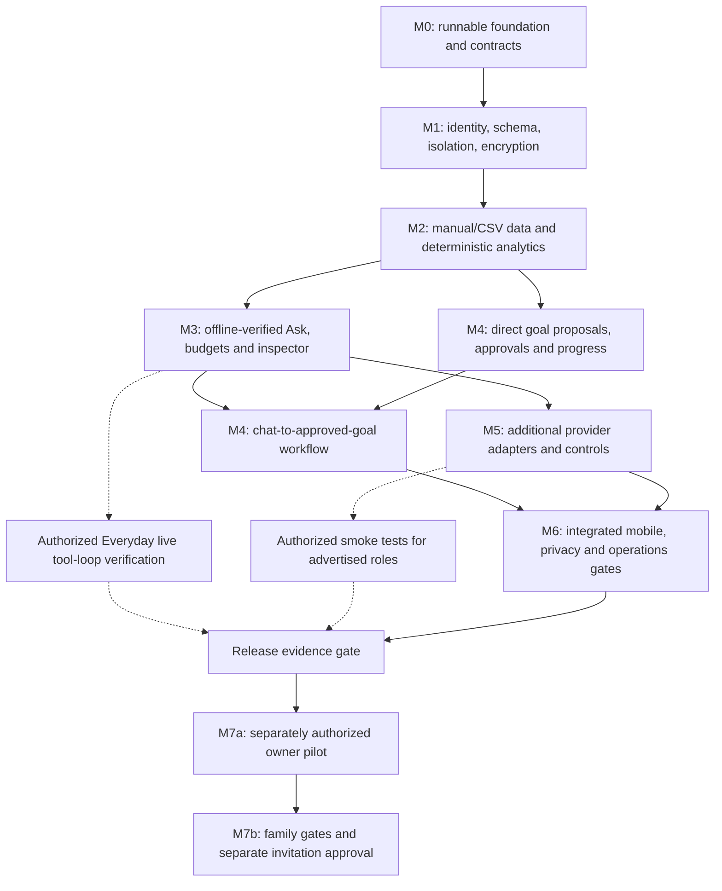

# Vulpes v0.1.0 execution plan

This is the preserved approved execution plan, integrated with the repository's milestone instructions. The specifications in [`../spec/v0.1.0/`](../spec/v0.1.0/) own product and acceptance requirements; [`../spec/v0.1.0/IMPLEMENTATION_PLAN.md`](../spec/v0.1.0/IMPLEMENTATION_PLAN.md) defines milestone outcomes, [`../spec/v0.1.0/ACCEPTANCE_TESTS.md`](../spec/v0.1.0/ACCEPTANCE_TESTS.md) defines release gates, [`../../AGENTS.md`](../../AGENTS.md) defines repository rules, and [`../DECISIONS_IMPLEMENTATION.md`](../DECISIONS_IMPLEMENTATION.md) records approved implementation decisions. This document owns the PR decomposition and session-resilient progress ledger.

## 1. Strategy and verified baseline

Build two independently verified foundations, then deliver working vertical slices through short PR stacks. Keep **two dependent PRs open by default, three maximum**, and retain milestone acceptance gates even when independent work proceeds across milestone boundaries.

At the time this plan was approved, the planning baseline was clean `main` at `b948383`. The repository contained specifications and assets, not an application. The specification validator passed **458 checks**. No application tests, provider calls, or deployments occurred; actual spend was **$0**. The documentation planning commit followed that snapshot.

This plan follows the canonical specifications, acceptance matrix, and installed Remora planning, engineering, testing, implementation, and review workflows.

Your confirmed sequencing preferences are:

- Complete Milestones 0 and 1 independently before starting feature stacks.
- Allow bounded stacks afterward.
- Continue independent local development when live-provider approval or access is delayed.
- Keep blocked live gates visible; synthetic tests cannot establish provider support or release readiness.

**Milestone 2 is the first useful deterministic vertical slice.** Milestone 3 adds the first AI-assisted slice. This distinction matters: imports, numerical analysis, goals, and account isolation must remain useful with every model disabled.

### Dependency graph

Solid arrows indicate implementation dependencies. Dotted arrows indicate separately authorized evidence gates.

Milestone 6 operations work can begin earlier against stable persistence contracts. Its final acceptance depends on all implemented stores and workflows.

## 2. Foundations and stable interfaces

Resolve these contracts before their dependents begin. Preserve the specified modular monolith; do not introduce an ORM, agent framework, queue service, plugin registry, or additional backend.

| Boundary | Decision and implementation requirement | Freeze point |
|---|---|---|
| Runtime and tooling | Strict TypeScript; existing React/Vite stack; npm with pinned compatible versions and lockfile. Use Vitest for unit/integration orchestration and Playwright for browser automation. Verify actual dependency compatibility during M0. | M0 |
| Shared contracts | Implement runtime schemas and inferred types in `shared/`, using Zod. Preserve nine API entry points, action discriminants, error envelopes, ownership-safe errors, pagination, and SSE v1. Reference specification contracts are not executable validation. | M0 |
| Client state | Use TanStack Query for server data and a small explicit conversation reducer for SSE/assistant-ui ExternalStoreRuntime. No second general-purpose state/cache layer or persisted health-data cache. | M0 |
| Identity and persistence | Verified session determines identity. Ordinary access uses user-scoped clients and RLS. Composite owner-parent constraints protect relationships; narrow transactional RPCs protect mutations. Privileged credentials stay confined to administrative/accounting operations. | M1 |
| Numerical representation | PostgreSQL `numeric` and decimal arithmetic for money and canonical measurement transformations; decimal money strings at interfaces. Convert measurement outputs to the specified numeric DTOs only at serialization boundaries. Test before display rounding. | M1–M2 |
| Measurements and analysis | One normalized schema for CSV/manual and a fixture-only Health Connect stub. Source, timezone, granularity, algorithm version, data revision, coverage, and evidence references remain explicit. | M2 |
| Proposals | Server-created canonical payload and hash, expected target version, owner, expiry, and single-use state. Approval accepts no replacement payload. Direct forms and AI tools share the same approval service. | Before M4 |
| Provider adapters | Separate generation and decision capabilities, normalized usage, provider-specific continuation data, and explicit unavailability. One server-side typed catalog; no model environment overrides. | M0 shape; M3 behavior |
| Request capture | Serialize the provider body once; encrypt those bytes before transmitting the same bytes. Capture each continuation separately. Reject SDK behavior that silently retries, transforms, or adds unaccounted requests. | Before M3 inference |
| Run and accounting lifecycle | Persistent admission, cancellation, terminal states, idempotency, atomic app/account reservations, original accounting period, and conservative unknown-cost settlement. Reconnection reads state; it never restarts inference. | Before M3 inference |
| Privacy lifecycle | Read-time expiry and deletion invalidation accompany each private store. Where precise trace dependency deletion is unavailable, purge affected owned conversation/run payloads as permitted by the specification. | Each introducing PR |

Use dependency checks to prevent domain/UI imports of provider SDKs and client imports of server modules. Keep `AnalyticsService` pure; authorize record access before passing inputs into it.

The schema foundation should cover the specified tables and constraints, but implement business functions alongside the feature that first exercises them. Do not fill the foundation with speculative service methods.

## 3. Proposed PR sequence

Each PR must build and pass its applicable tests against its declared base without requiring its child. Unfinished routes must be absent or explicitly unavailable, never appear to work.

### Independently verified foundations

Do not stack feature work on these foundations before their milestone gate passes.

| PR | Milestone and deliverable | Dependencies | Required proof |
|---|---|---|---|
| **01 — Runnable application foundation** | M0: strict TypeScript client/server builds, approved shell and branding, local API runner, scripts, dependency lockfile, routing, client/server boundaries, fail-closed configuration. | None | Production build; direct navigation; API errors remain JSON; client bundle inspection; zero model calls. |
| **02 — Contracts and replaceability harness** | M0: executable API/domain/SSE schemas, typed catalog, distinct adapter interfaces, synthetic transports, provider-smoke opt-in guard, documented capability verification and blockers. | 01 merged | Offline adapter contract tests; capability rejection; disabled-role status; attempted live smoke without opt-in denied; architecture checks. |
| **03 — Schema and isolation foundation** | M1: reviewed migrations for specified tables, indexes, composite ownership constraints, grants, RLS, synthetic two-user setup. | M0 accepted | Clean local database migration; authenticated A/B direct Supabase access tests; forbidden parent links and privileged writes rejected. |
| **04 — Authenticated shell and private payloads** | M1: server auth, sign-in/out, profile/settings/consent, account-switch cleanup, private payload encryption, expiry enforcement, provisioning documentation. | 03 merged | Real local sign-in/API workflow; stale stream/cache removal; encryption byte equality and tamper rejection; anonymous/foreign payload denial. |

**M0 gate:** coherent build and local routing, protected secrets, offline harness, honest provider status. Public provider documentation is checked, but authenticated capability and pricing evidence remains separately gated.

**M1 gate:** two-user isolation and authenticated workflows pass against real local persistence. No public signup. No feature stack begins with unresolved ownership or encryption defects.

### Progressive feature stacks

| PR | Milestone and deliverable | Dependencies | Required proof |
|---|---|---|---|
| **05 — Manual measurements and deterministic Data slice** | M2: measurement registry, normalization, manual entry, source selection, summaries, chart/table, insufficient-data states. Add read-only goal-progress calculation primitives needed later. | M1 accepted | Manual entry → persisted reading → exact summary in UI, with every model disabled; fixture and measurement-adapter parity tests. |
| **06 — CSV preview and transactional import** | M2: canonical CSV, bounded mapper, explicit profile/source/timezone selection, encrypted staging, preview, commit, duplicate/conflict handling. | 05 | Canonical and wide fixtures through actual HTTP/UI; reimport unchanged; altered values conflict; foreign/expired/tampered previews rejected. |
| **07 — Measurement correction, deletion and export** | M2: optimistic version checks, data revisions, cache invalidation, baseline-review markers, spreadsheet-safe CSV export, staging cleanup. | 06 | Correction/deletion changes analysis; no silent baseline rewrite; concurrent commit/correction tests; negative numbers survive safe export. |
| **08 — Persistent run admission, budgets and execution ledger** | M3: persistent concurrency/rate controls, reservations, idempotency, step ledger, encrypted exact request capture, cancellation/crash reconciliation. No enabled live inference. | 07 | Concurrent budget-boundary tests against PostgreSQL; trace failure prevents transport; unknown usage retains cost; month rollover settles into admission period. |
| **09 — Ask Vulpes tool loop and persistence** | M3: conversations, bounded context, Everyday adapter, SSE reducer, read tools, typed results, reload/cancel/failure behavior, sanitized rendering. | 08 | Synthetic provider drives real API → database → tool → stream → UI; tool continuation; duplicate send; disconnect/crash; evidence ownership; no automatic retry. |
| **10 — Inspector and Everyday integration gate** | M3: complete per-step inspector, context exclusions, request/body equality, usage labels, trace expiry/export warning, synthetic evaluation harness and guarded live test path. | 09 | Inspect actual stored request/tool evidence; malformed evidence rejected; midstream trace failure honest. Authorized live tool-loop evidence closes M3; otherwise gate remains pending. |
| **11 — Direct goals, approvals and progress** | M4: goal forms/list/detail, frozen baselines, create/revision/state proposals, transactional approval/rejection, explicit progress semantics and conflicts. | 07; M1 foundation | Forms → review → approve → progress works without AI; tamper, foreign owner, stale version, replay, insufficient data, regression and range cases. |
| **12 — Chat proposals and complete product journey** | M4: proposal tools/cards, before/after revision review, explicit confirmation, shared goal services. | 10 local gate + 11 | Sign in → import → ask → inspect → propose → approve → reimport → progress → reload. Ambiguous “yes” never performs a mutation. |
| **13 — Vertex roles and effective controls** | M5: Flash/Argon backend adapters, Luna-first chat, one evidence-backed Flash handoff, selector removal, observed effort, availability, consent and spend controls. Argon chat routing stays disabled. | 10 local gate | Recorded/synthetic transport contracts; opaque continuation preservation; unsupported depth denied; privacy/auth/timeout failures; live evidence separately authorized per role. |
| **14 — Optional decision adapter** | M5: typed scoring adapter, guarded routing integration, conservative fallback, evaluation comparison with deterministic routing. Remains disabled. | 13 | Malformed scores/uncertainty; disabled adapter preserves full core behavior; decision calls count toward total budget/call limits. Activation requires separate evidence and approval. |
| **15 — Mobile and accessibility completion** | M6: completed screen states, approved tokens, safe-area/keyboard behavior, static PWA shell, accessible charts and inspector, reduced motion. | 12 + 13 local gates; PR 14 optional | Required viewport/theme matrix; keyboard/focus/screen-reader checks; zoom; cache inspection; synthetic screenshots; mobile-device checks where available. |
| **16 — Account lifecycle and recovery operations** | M6: full export, resumable deletion, cancellation/admission coordination, complete retention cleanup, backup/restore verification and recovery runbook. | 12 + 13 local gates; PR 14 optional | Interrupted deletion and late provider completion cannot recreate data; export completeness; expiry after inactivity; restore to separate local environment with policies and encryption recovery. |
| **17 — Integrated acceptance and release evidence** | M6: full acceptance reconciliation, cumulative review, sanitized build-created report, provider evidence inventory, deployment/pilot checklist and documented limitations. | 15 + 16; required live evidence for release status | All applicable P0/P1 tests; F evidence tracked separately; no unresolved demonstrated blockers; explicit unavailable roles and skipped external checks. |

**PR 14 is optional and does not block downstream work.** It may be deferred while PRs 15–17 and other product work proceed. Decision scoring remains disabled unless its separate evidence and activation gates pass. Disabling it never reduces required core functionality.

### Stack discipline

- Start with two open dependent PRs. Permit a third only when parent interfaces have passed checkpoint tests and review has not identified likely contract changes.
- Merge from the bottom. Retarget/rebase descendants after parent integration and rerun relevant tests against the resulting base.
- Review each PR’s incremental diff and the cumulative stack at integration.
- Freeze downstream work when a parent changes ownership, transaction, lifecycle, or public contract semantics.
- Do not build a long speculative stack to compensate for slow review.
- Keep live-provider evidence gates separate from code review status. A locally verified adapter can merge disabled; it cannot be advertised as supported.

### Safe parallelization

After M1, the best independent packets are:

- PR 11 goals alongside PRs 08–10 Ask/accounting, after M2 contracts stabilize.
- Vertex transport implementation alongside goal/chat integration after PR 10’s local gate.
- PR 15 presentation work alongside PR 16 operations after their shared interfaces stabilize.

For any delegated execution, assign explicit file/module ownership, isolate worktrees, and retain one integration owner. Serialize migrations, shared DTO changes, package manifests, and lockfile changes. Keep the total active dependent PR work within the same 2–3 PR limit.

Independent review can run while unrelated implementation proceeds. Reviewer independence does not replace executable evidence.

## 4. Verification and integration gates

Every implementation packet follows Remora’s sequence:

1. Reinspect baseline, authorization, affected contracts, and acceptance IDs.
2. Implement one bounded packet using `remora-implement-plan`.
3. Run focused checks and demonstrate the actual interface.
4. Apply `remora-review-change` separately to **specification fulfillment** and **engineering/security/maintainability**.
5. Correct demonstrated blockers and rerun affected checks.
6. Prepare the PR brief with `remora-prepare-pr`; publication remains separately authorized.

For PR descriptions, retain the project’s requested **Summary** and **Changes** structure, adding concise verification and material risks. Carry over Remora’s artifact-evidence requirements without competing description templates.

### Required test ownership

| Area | Required scenarios and acceptance coverage |
|---|---|
| Authentication and isolation | SEC-01–08 progressively, including direct Supabase access, composite parent ownership, session verification, provider revocation, account switching, CSP and routing. Repeat isolation whenever a store/route is added. |
| Data and analytics | DATA-01–15; canonical fixture: 69.7 kg → 69.0 kg, −0.7 kg; tolerance `1e-9` before display rounding. Add multiple daily readings, DST ambiguity, source conflicts, sparse windows, mixed units and nonfinite inputs. |
| Goals | GOAL-01–06, including atomic replay, concurrent revisions, exact displayed-payload binding, zero denominator, range state and baseline invalidation. |
| AI and evidence | AI-01–09, TRACE-01–06, supplied evaluation cases plus adverse cases. Test actual tools/context/renderer; synthetic provider tests establish orchestration, not live model safety. AI-10 applies before optional decision activation. |
| Accounting | COST-01–07, including simultaneous admissions, cancellation races, duplicate settlement, crash recovery, unknown pricing, overlapping token categories and uncertain spend. |
| Replaceability | MOD-05 from M0; normalization parity in M2; full MOD-01–03 in M3/M5; MOD-06 throughout Data/Goals. Provider swaps cannot require changes to domain services. |
| Operations and UI | OPS-01–06 and UI-01–06 at their applicable P0/P1/F gates. Browser emulation does not prove physical keyboard behavior or deployed routing. |

### Commands to establish during implementation

These commands are required future scripts, not checks already run:

- Every PR: `npm run lint`, `npm run typecheck`, `npm test`, `npm run build`.
- Persistence/transaction changes: `npm run test:integration`.
- User-facing slices: `npm run test:e2e` plus inspected HTTP/UI evidence through `npm run dev:full`.
- Retention/recovery: `npm run maintenance:cleanup`, `npm run backup:verify`, restricted to disposable local environments unless otherwise approved.
- Provider evidence: `npm run test:providers`, guarded by explicit role, synthetic inputs, authorization and a bounded budget.
- Specification changes: `python docs/spec/v0.1.0/scripts/validate_spec_package.py`.

Use local Supabase for real database/auth/RLS tests. Missing Docker, database services, browser tooling, or credentials are explicit blocked checks; mocks cannot replace the missing integration evidence.

Ordinary CI contains no live model calls, production credentials, or real health records. Release evidence contains commands, versions, results, synthetic screenshots and safe smoke metadata. Full prompts and private trace payloads remain outside repository evidence.

### Completion levels

- **Local feature complete:** actual local persistence and user flow verified; external boundaries explicitly pending.
- **Milestone complete:** every specified exit criterion passed, including required live evidence.
- **Release ready:** applicable P0/P1 matrix, at least one live generation provider, and genuine smoke evidence for every advertised role.
- **Pilot authorized:** separate owner permission for deployment and real data; family invitation has additional F gates.

No failed P0 is waivable. A provider approval delay may permit independent development, but cannot convert “pending” into “passed.”

### Session-resilient PR progress ledger

Use only these states. A PR's local status and its milestone's live acceptance gate are distinct; a local pass cannot be reported as a live-provider or release pass.

| State | Meaning |
|---|---|
| **Proposed** | Planned; implementation has not started. |
| **In progress** | Implementation has started; required checks or evidence remain incomplete. |
| **Locally verified** | The PR's local checks and real local artifact evidence passed. External/live acceptance gates may still be pending. |
| **Fully accepted** | The PR and applicable milestone acceptance criteria passed review, including required live evidence. This does not authorize deployment, real-data use, or a pilot. |

Update the ledger from observable repository evidence. For each change, record the date, PR or commit, exact commands and outcomes, artifact inspected, and any blocked external gate. A configured command is not a result. Never claim full milestone acceptance while a required criterion remains pending. Keep secrets and health content out of the ledger.

| PR | Status | Evidence or blocker |
|---|---|---|
| 01 | Fully accepted | Merged as `b507bea` (#1), 2026-10-24. M0 application foundation accepted with build/routing, secret-canary and browser evidence. Historical commands/results remain in [PR 01 evidence](../evidence/pr01-foundation.md). No deployment or live inference. |
| 02 | Fully accepted | Merged as `c36d0ab` (#2), 2026-10-24; merged GitHub record verified before PR 03. Cumulative M0 local gates pass: executable contracts, offline provider harness, build/routing and protected client bundle. [PR 02 evidence](../evidence/pr02-contracts.md), [provider report](../evidence/PROVIDER_SMOKE_TESTS.md). Required authenticated provider evidence remains a later gate; live smokes are `not_run`. |
| 03 | Fully accepted | Merged as `bc490e4` (#3), 2026-10-24; refreshed `origin/main` confirms the implementation base. Schema/RLS and synthetic two-user foundation evidence remains in [PR 03 evidence](../evidence/pr03-schema-isolation.md). Its reviewed local checks passed; M1's authenticated-shell/encryption portion is owned by PR 04. |
| 04 | Fully accepted | Merged as `fc9e620` (#4), 2026-10-24; [original evidence](../evidence/pr04-auth-private-payloads.md). The independent cumulative review found a direct-RPC display-name defect and two test defects. Remediation commit `a090fc7` preserves merged history and passes 208 unit, 65 real integration, 413 pgTAP, and 35 browser checks, plus lint, strict build/typechecks, database lint/type comparison, and the six-file secret scan. [Reproduction and focused split-axis self-review](../evidence/m0-m1-review-remediation.md). The remediation and M1 were accepted in chat on 2026-10-25; [remediation PR #5](https://github.com/edumarcano/vulpes-health/pull/5) merged as `f4939df`; implementation base verified on 2026-10-25. Hosted/live gates remain separate. Spend: $0. |
| 05 | Locally verified | Merged as `5b00a68` (GitHub #6), verified 2026-10-25. 2026-10-25, branch `feat/pr05-manual-data` from refreshed `main` at `f4939df` (merged M1 remediation #5). Manual entry, exact normalization/analysis, owned sources and Data chart/table verified: 238 unit, 74 real integration, 421 pgTAP, 51 built-browser and four development proofs; strict builds, lint, numeric fixture oracle and bundle scan passed. [Checkpoint evidence and split-axis self-review](../evidence/pr05-manual-data.md). PRs 06–07 and independent M2 review remain pending. No deployment/provider requests; spend $0. |
| 06 | Locally verified | Merged as `aacc489` (GitHub #7), verified 2026-10-25. Branch `feat/pr06-csv-import` started from `5b00a68`, after PR 05 merged. Canonical/wide preview and encrypted transactional import, replay, conflicts, profile/source exclusions, source warnings, stale/foreign/expired/tampered denial and rollback verified: 249 unit, 87 real integration, 443 pgTAP, 71 built-browser and eight development proofs; strict builds, lint, schema/type checks, forward upgrade and secret scan passed. [Evidence, retained failures and split-axis self-review](../evidence/pr06-csv-import.md). Descendant status is below; independent M2 review remains pending. No deployment/provider requests; spend $0. |
| 07 | Locally verified | Merged as `0e59d8c` (GitHub #8), verified 2026-10-25. 2026-10-25, branch `feat/pr07-measurement-lifecycle`, from refreshed `main` at `aacc4897b9ba08b15c0a6c0b4dc758212ef56fd8`; actual PR parent is `main`. Versioned correction/deletion, frozen-baseline review markers, exact spreadsheet-safe streamed export and staging cleanup verified: 266 unit, 99 real integration, 457 pgTAP, 88 final built-browser checks through the diagnostic runner and nine standard development proofs. Strict builds/lint, forward upgrade, schema/type checks, eight-file bundle scan and 478 specification checks pass. Local server losses, limitations and the approved split-axis self-review are retained in [evidence](../evidence/pr07-measurement-lifecycle.md). Independent cumulative M2 review found F1; [timestamp remediation](../evidence/m2-timestamp-remediation.md) addresses it. M2 acceptance remains pending. No hosted resource/provider request; spend $0. |
| 08 | Locally verified | 2026-10-26, `feat/pr08-run-accounting` from verified `main`/`origin/main` at `fe6675b`. Explicit PR 08 implementation/publication authorization permits this scoped foundation while recorded M2 acceptance remains pending. 279 unit, 127 real integration, 546 pgTAP, 92 built-browser and nine development proofs passed, along with strict build/lint, bundle canaries, clean/forward migrations and standalone accounting proof. The approved app/account terminology follow-up adds a sixth data-preserving migration, 555 current pgTAP checks and populated reserved/pending/settled upgrade proof. [Evidence, retained failures and split-axis self-review](../evidence/pr08-run-accounting.md). No provider request, deployment or real data; spend $0. M3 live acceptance remains pending. |
| 09 | Locally verified | 2026-10-26, `feat/pr09-ask-conversations` from merged PR 08 on `main`/`origin/main` at `98b097d`; actual PR base is `main`. Explicit PR 09 implementation/publication authorization preserves recorded M2 acceptance as pending. Persistent Ask, bounded read tools/context, Everyday Responses wire adapter and durable SSE verified with 292 unit, 146 final clean-schema integration, 582 pgTAP, 100 built-browser and 17 Vite development checks. Clean/populated upgrades, actual maintenance, bundle canaries and both Remora self-review axes passed. [Evidence, screenshots and retained failures](../evidence/pr09-ask-conversations.md). Native Windows Vite-preview failure remains documented; built tests serve the real bundle through the existing synthetic Node composition. No provider request/deployment/real data; spend $0. PR 10, independent M3 review and required live evidence remain pending. |
| 10 | Locally verified | 2026-10-27, `feat/pr10-execution-inspector` from PR 09 at `1e6e96e`; dependent PR targets the PR 09 branch while it remains open. Owned step inspection, exact byte export, usage and context transparency, guarded synthetic verification and durable route-cost blocks passed 297 unit, 150 PostgreSQL integration, 620 pgTAP, 100 built-browser and 17 development-browser checks. Populated upgrade, synthetic evaluations and split-axis self-review passed. [Evidence and remaining gates](../evidence/pr10-execution-inspector.md). No provider request, deployment or real data; spend $0. Independent M3 review identified F1 completion-metadata loss and F2 historical replay errors; [review remediation](../evidence/m3-review-remediation.md) addresses both. The [M3 repair and live re-verification](../evidence/m3-live-reverification.md) passed the required technical gates on the uncommitted repaired working tree: genuine Everyday answer, exact API/browser evidence and reload, and guarded cancellation/disconnect with conservative holds. Independent repair review approved both axes. Integration and formal milestone acceptance remain separate; production inference stays disabled. Original failures and actual billing are preserved in the evidence. |
| 11 | Locally verified | Merged as `d35902e` (GitHub #16). Verified 2026-10-28, `feat/pr11-direct-goals` from merged GitHub #15 at `f35b249`. Direct forms, frozen baselines, exact approval/rejection, replay/conflict isolation, progress and review history verified without AI. 314 unit, 642 pgTAP, 167 full integration and 102 full built-browser checks passed; final focused refinements passed eight goal integration tests and built/development Goals proof. Populated forward upgrade, schema/type checks, 493 specification checks and bundle scan passed. [Evidence, retained failures and split-axis self-review](../evidence/pr11-direct-goals.md). Formal M4 acceptance remains pending; PR 12 status is below. No live inference/deployment/real data; spend $0. |
| 12 | Locally verified | Merged as `9463b2e` (GitHub #17), following PR 11 at `d35902e`. Verified 2026-10-28 on `feat/pr12-chat-goals`, originally stacked on PR 11 at `c8a6575`. Pending-only tools, atomic proposal/evidence/message checkpointing, typed review/progress cards, explicit approval and owned reload verified synthetically. 317 unit, 648 pgTAP, 184 full integration and 105 full built-browser checks passed; final affected reruns passed 45 integration cases, then 37 after contract completion, plus four built and four Vite proofs. Populated PR 11 upgrade, 16 synthetic controls, accounting proof, schema/types, bundle scan and 495 specification checks passed. [Evidence, retained failures and both Remora self-review axes](../evidence/pr12-chat-goals.md). Independent cumulative M4 review found two blockers: latest daily-total progress excludes today, and approving a chat revision leaves cached progress visible. [Remediation and retained verification results](../evidence/m4-review-remediation.md) address both findings; integration, formal acceptance and live-provider proposal evidence remain pending. No deployment, real data or provider requests; spend $0. |
| 13 | Locally verified | 2026-10-29, `feat/pr13-vertex-routing` from `e941890` on `main`. Vertex wire adapters, one bounded Flash handoff, encrypted capture, policy/consent guards and selector removal verified: 328 unit, 196 full integration, 663 pgTAP, 107 built-browser and six development-browser checks; populated forward upgrade, accounting proof, 16 synthetic evaluations, schema/types, lint/build/bundle and both Remora self-review axes passed. [Evidence and retained failures](../evidence/pr13-vertex-routing.md). Production remains unavailable; Google access, region/privacy approval, prices and live evidence are pending. No provider calls or spending. PR 14 remains deferred. |
| 14 | Proposed | Deferred by the approved M5 decision; remains disabled and does not block PRs 15–17. |
| 15 | Locally verified | 2026-10-29, `feat/pr15-mobile-pwa` from refreshed `172b5cb`. Static public-only PWA, responsive branding/states, inspector recovery and Goal zoom containment verified: 328 unit, 111 built-browser, 28 Vite/API, seven final affected mobile checks and standalone PWA proof; strict build/lint, bundle scan and both self-review axes passed. [Evidence and retained failures](../evidence/pr15-mobile-pwa.md). Physical devices, actual assistive technology and hosted gates remain unverified. No deployment/provider requests; spend $0. |
| 16 | Locally verified | 2026-10-29, `feat/pr16-account-recovery` from integrated PR 15 at `a7551fe`. Complete owned export, resumable deletion/fences, retention and separate encrypted restore/recovery verified with synthetic local accounts: 333 unit, 720 pgTAP, an earlier 211-case integration pass, 115 built-browser checks, populated forward preservation and actual maintenance. Final integration repeat was 210/211 with an unchanged cancellation case and its full 24-case file passing on rerun; development was 31/32 plus the unchanged failed case passing alone. Final affected built/development checks each passed eight cases, including lost initiation/final responses. [Actual outcomes, retained failures and both self-review axes](../evidence/pr16-account-lifecycle.md). Hosted recovery, live providers, physical devices and family gates remain unverified. No new dependency, deployment or provider request; spend $0. PR 14 remains deferred; combined independent M5/M6 review remains after PR 17. |
| 17 | Merged; acceptance blocked | GitHub #23 merged as `e822c0b` after PR 16 (#22). The 2026-10-30 verification candidate was `feat/pr17-release-evidence` from `508757f`. Integrated evidence collector, all 70 acceptance rows, five reviewed synthetic screenshots, provider inventory and deployment/pilot checklist implemented. Final candidate: 336 unit, 720 pgTAP, 211 integration with explicit `--pool=threads`, 116 built-browser and one PWA check passed; populated upgrade, accounting controls, maintenance and separate encrypted restore passed. Development remains failed: 30/33, then unchanged 32/33 with a different inspector assertion failure. Native integration-worker exits and all attempts remain recorded; no exact root cause is claimed. [Evidence and split-axis self-review](../evidence/pr17-integrated-acceptance.md), [build-created report](../evidence/release/m6-local.json). Axis 1 is blocked by the development verification gap; Axis 2 approved with observations. Merge does not establish local acceptance or release readiness. The combined independent M5/M6 review completed with blockers; [remediation evidence](../evidence/m56-review-remediation.md) tracks their resolution. Required live-provider, hosted, physical-device, human/family and acceptance gates remain pending. PR 14 stays disabled; provider requests/spend 0/$0. |

## 5. Risks, decisions and approval boundaries

### Highest-risk implementation decisions

| Risk | Required resolution |
|---|---|
| Stale or inaccessible selected model identifiers | Verify public documentation during M0 and account access during authorized smoke tests. Preserve selections; report unavailable roles. Model/provider replacement requires approval. |
| Captured trace differs from transmitted request | Capture at the final transport boundary and send the captured bytes; test with a local HTTP receiver. Disable hidden retries and continuations. |
| Serverless interruption releases money incorrectly | Persistent admission and conservative reservations; stale-run reconciliation never implies zero cost. No detached background job assumption. |
| Data deletion leaves copies in traces or late writes | Apply dependency invalidation with each store; coordinate deletion with run admission and terminal writes. Test delayed provider completion during deletion. |
| Schema ambiguity creates approval bypasses | Settle canonical hashing, payload/version checks and transaction permissions before goal endpoints. No user-accessible direct write path to approved state. |
| Timezone/source errors produce plausible but wrong health trends | Carry provenance and granularity through normalization; test DST, daily medians, source changes and sparse coverage before presenting charts. |
| Missing persistence details emerge late | During M1, explicitly place data-revision state, deletion progress, run admission state and operator budget configuration in the schema. Avoid a generic workflow engine. |
| Mobile polish deferred too far | Build accessible shell, table alternatives and honest states with each slice. M6 verifies and finishes them. |
| Optional decision work delays the product | Keep disabled and off the release critical path if deferred. Require measured benefit before activation. |
| Local tests mistaken for deployment proof | Validate actual hosting behavior only in an owner-authorized synthetic deployment, before real-data use. |

### Remaining owner decisions and their deadlines

These are future gates, not reasons to block local foundations.

| Decision | Recommended default | Needed before |
|---|---|---|
| Live smoke authorization and maximum spend | Separate small, explicitly capped synthetic batch for each provider/role; no automatic replenishment. Exact ceiling follows verified pricing. | First live request |
| Google location, accepted retention and credentials | Explicit supported location and accepted policy; production WIF/OIDC. Service-account key only as an approved fallback. | Vertex activation |
| Unsupported generation role | Keep visibly unavailable; seek approval for replacement or revised release claims. | Advertising/releasing that role |
| Optional decision activation | Remain disabled until privacy, capability and comparative evaluations pass. | Activation |
| Hosting projects, region, plan and platform privacy settings | Owner-selected resources; no automatic provisioning or upgrade. | M7 deployment |
| Backup retention and family recovery | Adopt the proposed 30-day maximum encrypted backup retention; operator-assisted recovery for the small pilot unless SMTP is approved. Validate before use. | Operational deployment/family invitation |
| Real CSV and family participation | Explicit source/profile approval; owner pilot first, then one invited adult after F gates. | Real import/invitation |

Routine implementation choices already constrained by the specifications can proceed within authorized packets. New safety policy, materially changed persistence semantics, expanded retention, or public contract changes require owner alignment before affected work.

### Autonomy

This plan defines workflow boundaries; it does not itself grant authorization for implementation or external actions. Follow the current task-specific authorization and repository rules.

After a scoped implementation authorization, autonomous work may include local application code, reviewed schema implementation in disposable local databases, synthetic fixtures, deterministic tests, local browser verification, routine defect repair, and supporting documentation within that scope.

Explicit authorization remains required for:

- Commits/publication/PR creation/merging as applicable to the agreed Git workflow.
- Deployment, live migrations, cloud-resource changes, account creation or paid services.
- Provider calls, live activation, model substitutions, budget increases or privacy-policy changes.
- Real-data imports, consequential real-account changes, goal activation, deletion or sharing.
- Family invitations and pilot expansion.

Synthetic tests may exercise approvals and deletion inside isolated test accounts. That is not authorization to perform those actions on the owner’s account.

## 6. Milestone-instruction integration and M7 handoff

The repository guidance now points to this plan as the PR decomposition while keeping the specifications authoritative. Its execution rules are:

1. Start at M0 and verify M0 and M1 independently. Then implement dependency-bounded packets with approximately 2–3 dependent PRs open.
2. Verify one packet at a time per work lane while preserving milestone acceptance and the completion report.
3. Keep local implementation evidence separate from live-provider acceptance in M3/M5.
4. Add retention enforcement, private-store cleanup, cache invalidation and trace deletion hooks with the feature that creates each store; verify the complete lifecycle in M6.
5. Establish read-only goal contracts and calculation support before M3 tools; introduce mutation and approval behavior in M4.
6. Build core branding, accessibility and honest UI states into M0 and each slice; complete the viewport/accessibility verification in M6.
7. Track local status, live status and dependent PRs in this document's ledger.
8. Record approved sequencing deviations and material implementation choices in [`../DECISIONS_IMPLEMENTATION.md`](../DECISIONS_IMPLEMENTATION.md).

**M7 remains separately authorized.** After release-evidence review, deploy with synthetic data and live inference initially disabled; verify hosted auth, API routing, headers, storage privacy and operational recovery. Only then perform the approved owner data import and compare source readings with computed results. Observe actual provider and infrastructure usage.

Invite one adult family tester only after export, interrupted deletion, recovery, backup/restore, two-user adversarial isolation, provider consent and account/app budget gates pass. Deployment approval does not automatically authorize real-data import or family invitations.

## Owner-pilot continuation

The owner approved the owner-first plan on 2026-10-31: all P0s, core usability and hosted security/recovery before real data; physical Android first. Full release/family acceptance remains separate. The first packet completes dormant normal Luna composition, versioned privacy disclosure and guarded local budget provisioning. Current Luna live evidence, hosted preparation/recovery, hosted synthetic Ask/device verification and real-data authorization follow in order. No optional model activation or automatic merge is authorized.

Step 1 is locally verified on `feat/owner-pilot-luna-path`: 340 unit, 734 PostgreSQL, 222 integration, 121 built-browser and 38 final development-browser cases passed. [Evidence and split-axis self-review](../evidence/owner-pilot-step1.md) retain earlier failures and external limits. No live verification or activation is implied.

Step 2 technical verification passed for the bounded v7 synthetic checkpoint: all E01–E10, A01, tool-loop, cancellation and disconnect cases, with separate completed-answer review. [Current evidence](../evidence/luna-owner-pilot-live.md) retains five batches and the earlier mixed-method, context-overflow and false-capability findings. The orchestrator now makes room for a final answer by omitting tool schemas after removable history; it preserves safety/current results and rejects evidence that still cannot fit. Explicit account/input and bounded-memory instructions keep advertised capabilities accurate.

Verification: 345 final offline units; 229 ordinary integration cases on the context repair; 30 final v7 goal/batch cases; build/typecheck/lint and the 15-file bundle check passed. Across all five batches, 60 provider requests produced $0.006737220 reported settled ledger usage and $0.0186384 retained interruption holds. OpenRouter's key snapshot reported $0.00677838 total usage under the unchanged $0.50 cap. The owner authorized necessary synthetic batches within that cap; no further batch approval is needed in that scope. Production remains disabled and all verification stacks are stopped with evidence/allocations preserved.

Step 3A local preparation is verified on `feat/owner-pilot-hosting-preparation`: target-bound create-only configuration/migration artifacts, exact Supabase CSP, inference-off hosted build guard, disabled Git deployments, private upload exclusions and a bounded public probe. Verification: 366 offline units, strict build/typecheck/lint, 15-file bundle canaries, 14 real local HTTP checks, one PWA privacy check and 515 specification checks. [Evidence and self-review](../evidence/owner-pilot-step3.md), [checkpoint/owner procedure](../operations/synthetic-hosting.md).

Step 3B resources are approved for North Virginia, Free/Hobby only, $0 paid allowance. Vercel `vulpes-synthetic` uses the verified active Hobby account and Node 24; Git is disconnected. The API accepted `iad1`, a 240-second default and system-variable exposure; dashboard/runtime confirmation remains pending. The scoped Supabase API independently confirms the source is healthy in `us-east-1` on PostgreSQL 17. The owner reports Free and Supabase MFA; Vercel MFA is independently confirmed and the owner confirmed training/sharing opt-out. The unrelated project remains untouched. Recovery is explicitly deferred with `recoveryProjectRef: null`; a separate verified hosted-source restore remains required before real data, with a disposable local destination a candidate to investigate.

Step 3C technical deployment verification passed on 2026-11-01 with inference off and $0 paid allowance. Candidate `bf42111` passed both CI checks; the isolated upload matched 432 candidate files plus one reviewed generated configuration overlay. The source has the exact 38 reviewed migrations, 19 RLS-enabled public tables, two synthetic identities/profiles and no Storage objects. Signup is disabled, anonymous signup is denied and seven Production-only Vercel variables include three server Secrets with no provider credentials. Deployment `dpl_Cdw4DeExKHYHzT66wdDu1Njd3UXN` serves [the synthetic site](https://vulpes-synthetic.vercel.app) in `iad1`. Fourteen public probes, 12 authenticated API checks, basic own/cross-profile RLS and the two-account mobile Chromium smoke passed, including completed logout/reload and loaded-bundle private-key canaries. [Hosted evidence](../evidence/owner-pilot-hosted-setup.md) retains failed attempts and the CLI working-directory correction. The owner confirmed successful sign-in/navigation/logout handoff. Documentation head `18e4466` also passed both CI checks. No model calls, real data or paid spending occurred. Step 3 remains incomplete: broad isolation, hosted recovery/maintenance, backup/journal/key custody, devices, formal acceptance and PR integration are separate gates; no automatic merge is authorized.

Step 3D.1 on `feat/owner-pilot-hosted-security` adds a repeatable stdin-only security preflight without administrative/provider keys. Against the unchanged hosted candidate, all 87 checks passed: 19 anonymous table denials, eight protected-table denials per owner, owner-ID samples, foreign profiles, API availability/ownership, malformed queries and ended test-session denial through API/direct profile reads. Twenty empty samples explicitly leave populated isolation pending. [Evidence/self-review](../evidence/owner-pilot-step3d.md) records the initial overly specific error-code assertion and correction; HTTP 401 denial remained required. Local verification passed 381 units, strict typecheck/lint and the opt-in CLI refusal. [Remaining packets](../operations/synthetic-hosting.md#remaining-step-3d-packets) separate populated lifecycle, hosted maintenance and fenced hosted-source recovery. Next is explicit 3D.2 approval for two newly created disposable synthetic identities, their reset/deletion and denial tests; no existing account, backup export, deployment, cost or activation is included.
